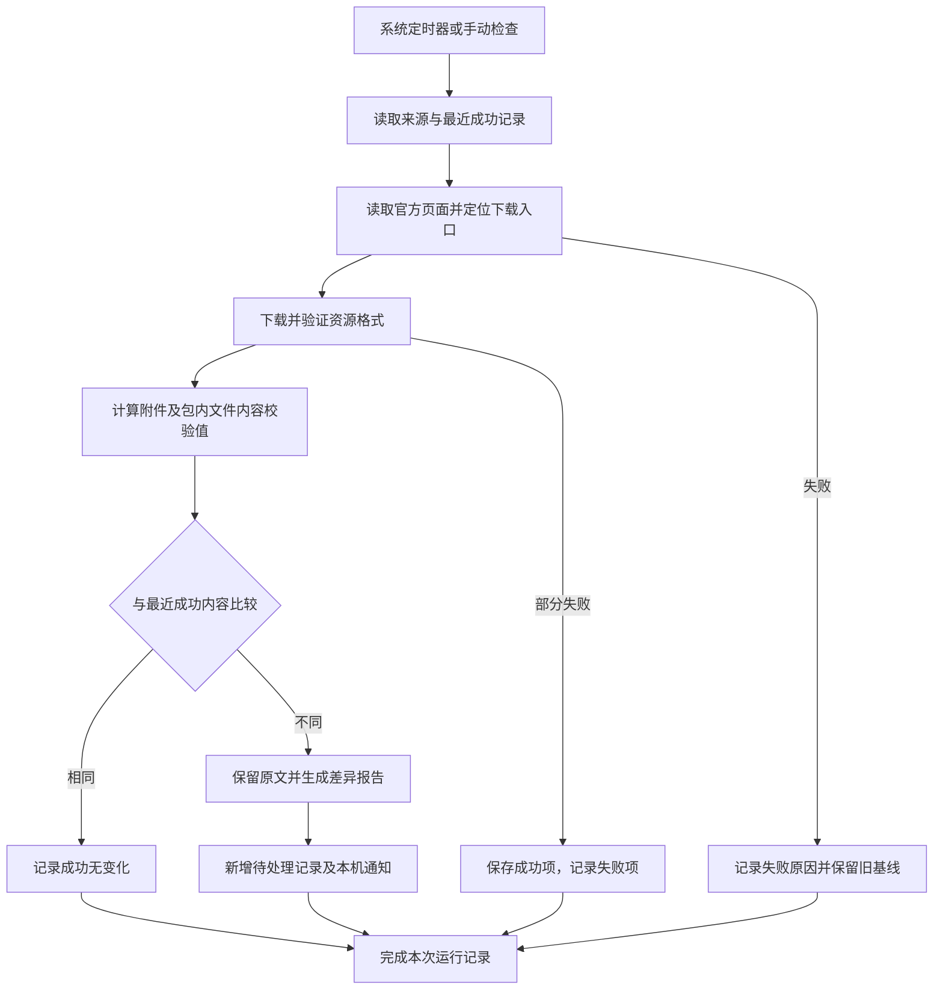
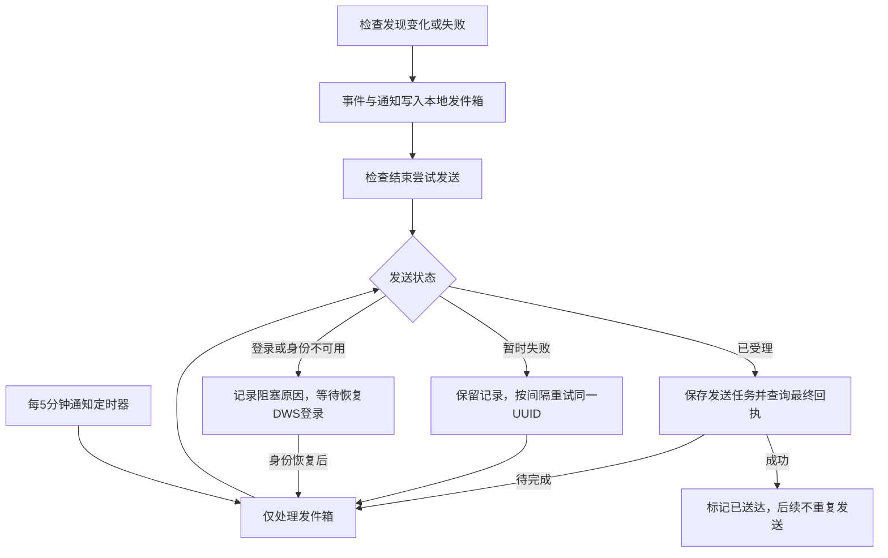

# 欧委会 DPP 语义资源更新跟踪设计

用户需要及时知道官方模型是否更新，并能追溯改了什么；整个监控过程应独立于大模型和模型额度。第一版采用“本机定时检查＋原文件留存＋固定规则对比＋中文报告＋待处理记录”的方式。

## 功能范围

| 功能 | 行为 |
|---|---|
| 来源发现 | 从欧委会资源页面定位语义资源的下载入口，发现下载地址或发布日期变化 |
| 原文获取 | 下载语义资源 ZIP 和指南 PDF，检查格式及文件完整性 |
| 内容比较 | 同时比较附件校验值与 ZIP 内文件内容，识别同名附件更新 |
| 规则比较 | 对 Schema 定位字段、类型、required、枚举、范围和格式变化；对 SHACL／词表保留变化摘要 |
| 更新待办 | 新变化形成待处理记录，支持“已查看”“忽略”和重新设为待处理 |
| 运行追踪 | 区分成功无变化、发现变化、部分失败和全部失败，展示最近一次成功检查时间 |
| 文件留存 | 保留原始文件、检查结果、版本与变更报告，便于复核 |
| 定时运行 | 系统用户定时器每天按欧洲时间启动，不依赖浏览器、聊天会话或大模型进程 |
| 局域网查看 | 内网用户通过同一个地址查看报告、手动检查和标记处理；来源网络与访问主机受配置约束 |
| 钉钉提醒 | 有变化或检查失败时，通过现有DWS身份给已确认的本人发送个人消息，持久化队列跟踪最终结果 |

## 默认监控对象

来源页面为欧委会 DG GROW 的 [DPP Resources & documentation](https://single-market-economy.ec.europa.eu/single-market/digital-product-passport/resources-documentation_en)。默认关注：

- **DPP Registry – Semantic Data Artifacts**：实际的 JSON Schema、SHACL、JSON-LD Context、词表与样例。
- **DPP Registry – Semantic Data Guide**：模型、分层、校验和版本管理说明。

页面日期只是一条证据，不单独作为“模型未变化”的依据。同一地址可能替换附件，下载链接也可能更换，因此必须读取实际内容进行比较。历史的 2026-10-30 原始包可作为初始参考；建立参考基线不表示当时完成过一次在线检查。

## 单次运行流程

每个资源独立推进最近成功内容。一个附件下载失败，不阻碍其他成功附件的有效变化被保存；失败资源不更新为不完整或错误页面。

## 变化与处理状态

运行状态和更新处理状态分开管理：

| 维度 | 状态 | 含义 |
|---|---|---|
| 检查运行 | 成功无变化 | 资源被成功检查，本次未发现内容变化 |
| 检查运行 | 发现变化 | 已保存新版内容，并生成差异记录 |
| 检查运行 | 部分失败 | 至少一项失败，不能把整次检查理解为“全部未变化” |
| 检查运行 | 失败 | 没有完成有效在线检查，需要排查或等待重试 |
| 更新处理 | 待处理 | 用户尚未确认该变化 |
| 更新处理 | 已查看 | 用户已阅读报告，是否修改业务模型仍由用户决定 |
| 更新处理 | 忽略 | 用户决定不跟进本次变化，证据继续保留 |

“已查看”不会自动升级业务系统。自动对比基线在资源成功保存后即可向前推进，不因用户尚未阅读而每天重复报告同一版变化；之前的待处理记录仍然保留。资源回退为旧内容，也应作为新的变化记录。

## 对比规则

第一层比较来源页面和下载入口，第二层比较附件字节，第三层比较资源包内内容。ZIP 的重新压缩、目录顺序和时间戳变化不应被误认为字段变化。JSON 的空白和对象键顺序变化也不应制造字段调整记录。

| 变化 | 报告处理 |
|---|---|
| 新文件／新字段 | 列出文件路径或 JSON Pointer；新增必填要求优先提示 |
| 文件／字段删除 | 提示可能影响现有输出、校验或引用 |
| required 增加、类型改变、枚举缩小、范围收紧 | 按固定规则提示“可能不兼容”，需要研发复核 |
| 标签、说明、scopeNote、词表或 SHACL 文本变化 | 保留差异与前后内容，不自动宣称改变了法定义务 |
| PDF 指南变化 | 保留新旧文件及校验值，提示人工阅读新版指南 |
| 附件仅重新打包 | 明确标识包装变化，和数据规则变化区分 |

兼容性判断是程序推断；完整语义影响还取决于 `$ref`／组合关系、上下文、对应业务适用条件及官方说明。第一版不运行完整 SHACL 引擎，不自动修改既有 Excel、Apifox 或生产模型。

## 时间、运行与提醒

定时器每天在 **Europe/Brussels 18:30** 运行，欧洲冬令时对应北京次日 **01:30**，夏令时对应北京次日 **00:30**。系统按时区计算，避免人工改时差。时间选择用于覆盖欧洲当天通常工作时间内的发布，不保证官方仅在工作时间发布。

本机无需一直打开浏览器或大模型，但需要开机、联网和可用的用户服务会话。错过计划时间后，定时器恢复时补跑一次。若要保证电脑关闭时仍检查，需要将程序部署到持续运行的主机；第一版没有自动租用云主机。

发现变化后，程序生成本机通知，网页持续保留待处理记录，并将允许的事件放入钉钉通知队列。夜间通知是否弹出由桌面通知及免打扰设置决定。通知未显示不影响检查与文件保存。钉钉推送只面向配置中已确认的本人，不向群或其他联系人自动发送。

网页以 **30 秒**为间隔读取本机结果，检查执行中缩短为 **2 秒**。这不等于每 30 秒抓取官网；官方资源仍由每日后端任务或用户手动触发检查。页面隐藏时暂停刷新，重新聚焦后立即读取最新状态。关闭页面不影响后端继续检查、存储或供其他用户访问。

## 钉钉通知的独立运行

通知发送使用本机的 DWS 命令行和现有组织／用户 Profile。核心监控无需安装第三方 Python 包；钉钉功能额外要求 DWS 已安装、已登录且当前身份有发送权限。DWS 登录凭证由 DWS 保存，监控配置只记录可执行文件路径、Profile、接收人和事件种类；没有模型 API 调用。

默认接收人是确认过的本人宁蒙昌。`resource_changed`、`page_changed`、`new_resource`、`check_failed` 事件可触发消息，成功但无变化的每日检查不发消息。

新增加的 `futris-dpp-watch-notify.timer` 在系统启动后约2分钟首次处理队列，随后每5分钟触发 `futris-dpp-watch-notify.service`。服务执行 `app.py notify-pending`，只处理已有通知和回执，不重新下载官网资源。官网检查仍由布鲁塞尔18:30的原定时器负责。

每条消息具有稳定 UUID，并持久化发送任务标识及最终回执。重试沿用同一 UUID，已有发送任务时优先查询状态；不能因网络超时就换新 UUID 再创建一条。程序中断后从发件箱继续，已送达消息不重发。队列处理使用独立进程锁，避免每日检查和通知定时器同时发送同一条记录。

认证过期、未登录或组织身份不匹配时，通知进入可追踪的阻塞状态。需要恢复对应DWS登录；这不消耗大模型Token，也不代表钉钉登录永久有效。网页、原文保存和差异比较继续工作，待发送消息不会丢弃。

## 数据与错误处理

- `config.json` 保存来源、重点资源与钉钉通知配置；`data/watch.sqlite3` 保存检查、处理状态及通知发件箱；`data/snapshots/<SHA-256>` 保存内容寻址的原文；`data/reports/<记录ID>.html` 和 `.json` 保存报告。
- 原文、检查记录、事件和报告保存在本机，不调用任何模型 API。
- 下载失败、重定向到错误页面、ZIP 损坏、页面结构变化等都记录为检查错误，保留上次成功基线。
- 报告展示来源与具体变化，不执行官方页面或资源包中的代码。
- 失败后下一次计划检查会重新尝试，也可以点击手动检查。
- 原始文件与历史默认不自动删除；需要保留多久、是否外部备份可按团队要求另外制定。
- 网页默认监听 `0.0.0.0:8768`，局域网入口为 `http://192.168.110.79:8768`。允许网络默认是 `192.168.110.0/24` 和 `127.0.0.0/8`；访问主机允许 `192.168.110.79`、`127.0.0.1` 和 `localhost`。内网用户共享查看与处理权限，不设置独立登录。实际允许范围、端口和访问地址保存在配置中，可随内网部署调整。

## 验收要点

1. 关闭大模型应用后，定时器和网页服务仍可独立运行。
2. 冬令时与夏令时都按布鲁塞尔 18:30 触发。
3. 页面日期不变而附件内容变化时，能产生更新记录。
4. ZIP 重新打包或 JSON 对象键顺序改变，不会误报为字段增删。
5. 类型、必填和范围调整能定位到具体 Schema 路径。
6. 网络失败不会显示“没有更新”，也不会覆盖成功基线。
7. 已查看与忽略操作不删除证据，后续新变化仍可继续跟踪。
8. 停用定时服务后，本地原文件、历史与报告继续保留。
9. 允许范围内的局域网设备可查看与标记处理；允许范围外的来源或未配置的访问主机被拒绝。
10. 网页常态30秒／检查中2秒刷新，隐藏时暂停；浏览器关闭后定时任务独立运行。
11. 变化或检查失败进入钉钉队列，成功无变化的检查不发消息；接收人限已配置的本人。
12. 通知重试及进程重启沿用同一UUID，已受理请求继续查回执，已送达记录不重复发送；登录失效保留阻塞记录，恢复后可继续。
