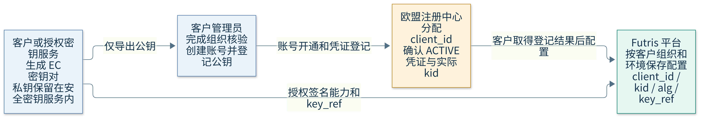
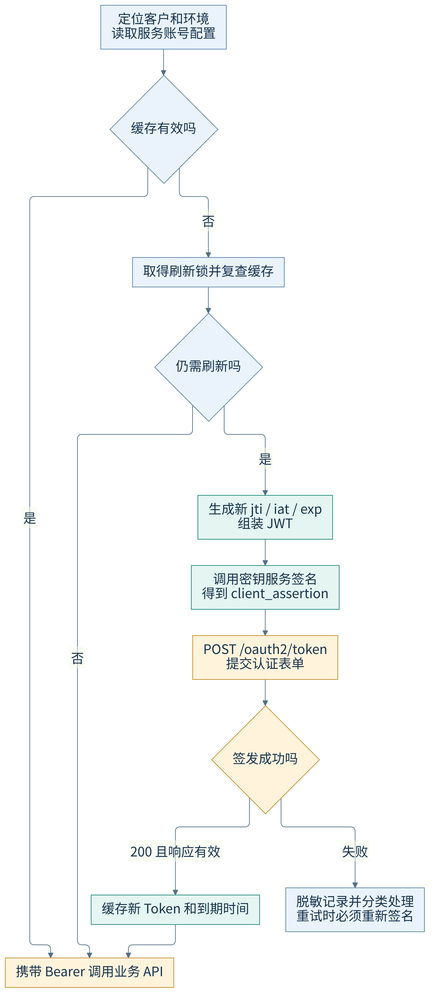
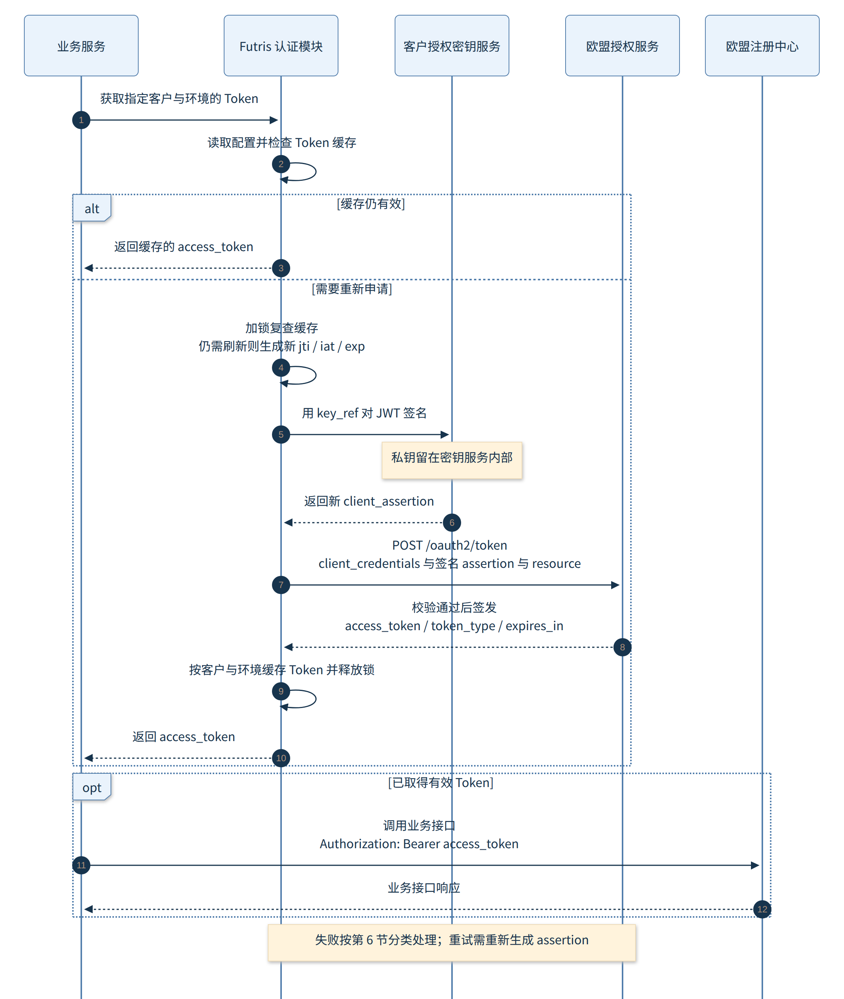

# Futris 欧盟 DPP 自动认证对接说明

client_assertion 自动签名与 access_token 自动获取

面向 Futris 产品、研发和实施团队。平台经客户组织授权后，使用客户在欧盟注册中心的 Service Account，自动生成 client_assertion，获取 access_token，并调用欧盟注册业务接口。

首次开通需要客户管理员和密钥服务参与；日常申请 Token 由程序自动完成。**Client ID 是欧盟注册中心分配的，私钥用于签名，jti 是程序每次新生成的随机流水号，access_token 由欧盟授权服务签发。**

版本 v1.0；更新于 2026-10-31 20:33（北京时间）。认证要求依据欧委会 2026 年 10 月 30 日技术资料；缓存、锁、重试次数和平台配置模型属于 Futris 实现方案。

## 1 参与方和适用范围

| 参与方 | 职责 |
| --- | --- |
| 客户组织及其管理员 | 完成 ACC 或 PROD 组织核验；创建 Service Account；登记公钥；确认实际 Client ID、ACTIVE 凭证的 kid 和业务权限；授权平台代为调用。 |
| 客户授权的密钥服务 | 由客户自行运营或授权平台运营，生成并保护 EC 密钥，按授权执行签名。私钥可以一直留在 HSM/KMS 中。 |
| Futris 认证模块 | 按客户与环境读取配置，生成 JWT claims 和 jti，调用签名服务，申请并缓存 Token。 |
| 欧盟授权服务 | 接收 /oauth2/token 请求，验证服务账号凭证与 assertion，并签发访问令牌。 |
| 欧盟注册中心业务服务 | 校验 Bearer Token 及权限，处理产品分类查询、护照登记和相关任务查询。 |

本方案覆盖 Futris 调用欧盟注册接口的认证。欧盟注册中心反向读取客户托管 DPP 的鉴权是另一条链路，不应把这里获取的 Registry Token 当成所有 DPP 服务的通用访问凭证。[S1 第 12 页]

## 2 字段由谁生成以及如何保管

> 客户负责开通和提供配置，并不代表所有字段都由客户自行生成。特别是 client_id 和 access_token 由欧盟服务产生，jti 和 client_assertion 由运行中的程序产生。

| 字段或材料 | 谁生成或确定 | 客户需要做什么 | Futris 如何处理 |
| --- | --- | --- | --- |
| client_id | 客户管理员创建 Service Account 后，由欧盟注册中心签发。 | 从账号配置中取得实际值，配置给平台。 | 按客户组织和环境保存；用于 Token 表单及 JWT 的 iss、sub。 |
| kid | 在公钥凭证登记环节确定，使用 Registry 实际登记的凭证值。 | 确认 ACTIVE 凭证对应的 kid 和算法。 | 作为长期配置放入 JWT header；不按请求重新生成。 |
| EC 私钥 | 客户或客户授权的密钥服务生成。 | 控制生成、保护和授权使用；同意平台执行指定用途的签名。 | 优先只保存 key_ref，调用密钥服务；不将明文私钥存入普通业务表。 |
| EC 公钥 | 从同一密钥对导出，与私钥匹配。 | 由管理员登记到欧盟注册中心。 | 可协助导出和配置；不能用公钥代替私钥签名。 |
| alg | 由已登记的曲线/凭证决定。 | 确认 P-256/ES256、P-384/ES384 或 P-521/ES512。 | 读取固定配置，与实际签名密钥匹配。 |
| issuer / Token URL / resource | 欧委会按 ACC、PROD 环境发布。 | 选择正确环境。 | 使用受控环境配置；不由最终用户随意填入任意 Token 域名。 |
| jti | Futris 程序在每次申请时生成新 UUID。 | 无需人工准备或向欧盟申请。 | 放入当次 JWT；重试也生成新值。 |
| iat / exp | Futris 程序依据当前时间生成。 | 无需逐次填写。 | 使用 Unix 秒；示例 exp = iat + 120，保持系统时钟同步。 |
| client_assertion | Futris 程序组装 JWT，并通过客户授权密钥服务签名产生。 | 提供持续有效的签名授权。 | 仅供本次 Token 申请使用，不作可重复使用的长期配置。 |
| access_token / expires_in | 欧盟授权服务验证成功后返回。 | 无需手工生成。 | 按客户、环境和授权范围缓存，并在到期前重新申请。 |

kid 的具体产生方式以公钥登记流程为准；对接时读取实际 ACTIVE 凭证值即可。本方案不假设 kid 一定由平台或欧委会某一方自动生成。[S1 第 6、8、13 页]

企业组织核验使用的 QSeal/QES，与本方案中 Service Account 使用的 EC 签名凭证用途不同。运行时签 assertion 不要求客户每次人工给声明文件签章。

### 2.1 客户首次需要提供的配置

```json
{
  "tenant_id": "平台内的客户组织标识",
  "environment": "ACC",
  "client_id": "从 Registry 创建的 Service Account 取得",
  "kid": "已登记 ACTIVE 公钥凭证的实际 kid",
  "algorithm": "ES256",
  "key_ref": "客户授权密钥服务中的密钥引用",
  "scope": null
}
```

私钥不放在上述普通配置 JSON 中。平台通过 key_ref 调用授权的密钥服务。客户自己保管密钥时，接入客户签名服务；客户授权平台代管时，在平台的安全密钥服务中生成和保护密钥。官方推荐 HSM 内生成不可导出的私钥，仅导出公钥登记。[S1 第 7–8、19 页]



图源：`图源/01_开通配置流程.mmd`

## 3 调用哪些接口

### 3.1 ACC 测试环境

| 配置项 | 官方地址或值 |
| --- | --- |
| 授权服务 issuer | https://auth.acc.product-passport.ec.europa.eu |
| 获取 Token | POST https://auth.acc.product-passport.ec.europa.eu/oauth2/token |
| Token 表单 resource | https://auth.acc.product-passport.ec.europa.eu/resources/dpp/registry |
| Registry API base  指南值 | https://reg.acc.product-passport.ec.europa.eu/api/v1 |
| 只读联调接口 | GET /api/v1/dpp/product-groups |
| 提交注册接口 | POST /api/v1/dpp/submission |

### 3.2 正式生产环境

| 配置项 | 官方地址或值 |
| --- | --- |
| 授权服务 issuer | https://auth.product-passport.ec.europa.eu |
| 获取 Token | POST https://auth.product-passport.ec.europa.eu/oauth2/token |
| Token 表单 resource | https://auth.product-passport.ec.europa.eu/resources/dpp/registry |
| Registry API base  指南值 | https://reg.product-passport.ec.europa.eu/api/v1 |

以上环境值见官方服务账号指南第 9、20 页。issuer 用于 assertion 的 aud；resource 用于 Token 表单；Registry API base 用于业务调用，三者不能互相替换。scope 仅按该服务账号已获授权的实际值选填，不填时不发送此参数。[S1]

> 业务 API 域名存在官方原文差异：服务账号指南使用 reg.acc / reg；原始 Registry 与 Dashboard OpenAPI servers 使用 registry.acc / registry。本方案保留差异。Token URL 是 auth 域名，未因此改成 registry。业务联调前应分别确认 Registry 与 Dashboard 的实际部署地址。[S1 第 20 页；S3]

2026 年 10 月 31 日的本机匿名检查中，ACC 的 reg 分类路径返回 401 并提示 missing session cookie，registry 分类路径返回门户 HTML。该检查未携带有效 Token；Token 端点尚未完成真实服务账号联调。实际环境的机器接入条件需要结合官方支持确认。

## 4 程序如何生成新的 client_assertion

jti 是 JWT ID，作用是标识当次凭证。client_id 标识长期服务账号，kid 标识已登记的签名公钥，jti 标识本次签名凭证。三者用途不同。程序调用 UUID 库即可生成新 jti，即使两次申请发生在同一秒，也应使用不同 UUID。[S1 第 10 页；S4]

| JWT 位置 | 字段 | 程序填写规则 |
| --- | --- | --- |
| Header | typ | 固定为 client-authentication+jwt。 |
| Header | alg / kid | 读取已登记凭证的算法与 kid，实际签名必须匹配。 |
| Payload | iss / sub | 两者均精确等于服务账号 client_id。 |
| Payload | aud | 精确等于当前环境授权服务 issuer，不是 /oauth2/token URL。 |
| Payload | iat / exp | iat 为当前 Unix 秒；示例 exp=iat+120；官方建议 60–120 秒，最长 5 分钟。 |
| Payload | jti | 每次新 UUID，包括 Token 请求的每次重试。 |
| Signature | ECDSA 签名 | JOSE/JWT 库调用对应私钥签名，输出完整的 compact JWT 字符串。 |

执行顺序是：读取固定配置 → 生成当前时间和新 UUID → 组装 JWT → 调用签名服务 → 把新签名字符串作为 client_assertion。平台不向欧盟传送私钥。[S1 第 9–10 页]

### 4.1 Python 签名示例

下面示例使用 P-256/ES256。private_key 表示从受保护存储中加载的 EC 私钥对象；采用 HSM/KMS 时，替换为对应的受控签名适配器，不能导出不可导出的密钥。完整缓存与重试实现见附件代码。

```python
import time
import uuid
import jwt

def create_client_assertion(client_id, kid, private_key):
    now = int(time.time())
    claims = {
        "iss": client_id,
        "sub": client_id,
        "aud": "https://auth.acc.product-passport.ec.europa.eu",
        "iat": now,
        "exp": now + 120,
        "jti": str(uuid.uuid4()),
    }
    headers = {
        "typ": "client-authentication+jwt",
        "kid": kid,
    }
    return jwt.encode(
        claims, private_key,
        algorithm="ES256", headers=headers,
    )
```

函数返回值就是 client_assertion。每次申请 Token 都重新调用；不要缓存上一次签好的 assertion 再重放。PyJWT 安装方式为 pip install "PyJWT[crypto]"；Java 和 TypeScript 的官方签名示例分别见服务账号指南第 13、14 页。[S1；S5]

## 5 用 assertion 自动申请 Token

### 5.1 请求地址和表单

```http
POST https://auth.acc.product-passport.ec.europa.eu/oauth2/token
Content-Type: application/x-www-form-urlencoded

grant_type=client_credentials
client_id=<Registry 签发的 Client ID>
client_assertion_type=urn:ietf:params:oauth:client-assertion-type:jwt-bearer
client_assertion=<本次新签名的 JWT>
resource=https://auth.acc.product-passport.ec.europa.eu/resources/dpp/registry
scope=<按既有授权选填，未配置时不发送>
```

上面是参数展示，实际程序应交给 HTTP 客户端做表单编码。OAuth grant_type 是 client_credentials；client_assertion_type 描述客户端 JWT 凭证类型。此流程不使用用户登录密码，也不使用共享 client_secret。[S1 第 9–11 页；S2]

### 5.2 Python 请求示例

```python
import requests

assertion = create_client_assertion(client_id, kid, private_key)
response = requests.post(
    "https://auth.acc.product-passport.ec.europa.eu/oauth2/token",
    data={
        "grant_type": "client_credentials",
        "client_id": client_id,
        "client_assertion_type":
            "urn:ietf:params:oauth:client-assertion-type:jwt-bearer",
        "client_assertion": assertion,
        "resource":
            "https://auth.acc.product-passport.ec.europa.eu/resources/dpp/registry",
    },
    timeout=(5, 20),
    allow_redirects=False,
)
# 成功后解析 access_token、token_type、expires_in。
# 出错时记录脱敏诊断，不打印请求凭证或整个响应体。
```

### 5.3 成功响应和业务调用

```json
{
  "access_token": "<欧盟授权服务签发的访问令牌>",
  "token_type": "Bearer",
  "expires_in": 900,
  "scope": "<实际授予的 scope，如返回>"
}
```

access_token 由欧盟授权服务签发，不是 Futris 自己生成。有效期内复用，实际以 expires_in 为准，官方最长 15 分钟。快到期时重新签 assertion 并再次申请 Token，不依赖本方案未定义的 refresh_token。[S1 第 11、15 页]

```http
GET <已确认的 Registry API base>/dpp/product-groups
Authorization: Bearer <access_token>
Accept: application/json

POST <已确认的 Registry API base>/dpp/submission
Authorization: Bearer <access_token>
Content-Type: application/json
Idempotency-Key: <一次逻辑提交的幂等键>
```

Token 成功仅表示获得相应访问授权。提交注册后的 202、任务结果和最终注册编号，仍按各业务接口的合同单独判断。[S6 第 7、9–10 页]



图源：`图源/02_自动认证流程.mmd`



图源：`图源/03_自动认证时序.mmd`

## 6 缓存并发和失败处理

### 6.1 Futris 缓存方案

认证模块按客户组织、环境、Service Account、resource、scope 和凭证版本隔离缓存。示例缓存键包含 tenant_id、environment、client_id、resource、scope、kid、key_ref 和 algorithm。客户撤销授权或切换凭证时，停用相关配置并清理对应缓存。

先检查缓存，失效后取得对应刷新锁并再次检查。只有一个请求去申请 Token，其他请求复用结果。代码附件提供单进程线程锁；多实例部署应接入分布式缓存与分布式锁，不能把单机锁描述成跨实例锁。

提前更新的安全窗口属于实现选择。附件采用 min(60 秒, expires_in × 10%)，并从请求发起时刻保守计算可用期限。例如 expires_in=900 时，约 840 秒后重新申请。该窗口不是官方强制参数。

### 6.2 异常处理规则

| 现象 | 处理方式 | 是否重新生成 assertion |
| --- | --- | --- |
| invalid_request / invalid_client | 停止盲目重试；检查表单、Client ID、kid、签名、aud、时间、jti、ACTIVE 凭证和组织资格。 | 配置改正后重新申请时生成新值。 |
| invalid_scope / invalid_target | 核对该账号已授权的 scope，以及当前环境的 resource；不通过扩大 scope 尝试提权。 | 改正后重新申请时生成新值。 |
| 429 / 503 / 临时网络故障 | 遵守 Retry-After，并有上限地退避重试。示例最多 3 次，加入随机抖动。次数和抖动是实现选择。 | 每次重试都重新生成，不能重放旧 JWT。 |
| Token 响应是 HTML 或缺少必要字段 | 不缓存；核对路由、网关与服务状态。不能把 HTTP 200 当成 Token 签发成功。 | 恢复后重新申请时生成新值。 |
| 业务 API 返回 401 | 先检查响应是否来自真实 API；如确认是 Token 失效，失效对应缓存并重新申请，最多重试业务请求一次。 | 需要申请新 Token 时生成新值。 |
| 业务 API 返回 403 | 检查组织状态、接口权限、Token audience；不循环换 Token。 | 不以重复签名替代权限修复。 |

以上 OAuth 错误含义依据官方指南第 18 页；缓存策略、最多 3 次认证重试、一次业务重试是本方案选择。提交注册的同一逻辑请求若重试，必须保持原请求体和 Idempotency-Key；修改逻辑请求才换新幂等键。[S1；S6 第 9–11 页]

### 6.3 凭证轮换

客户登记新公钥凭证，平台配置新的 kid 和 key_ref，验证新凭证可申请并使用 Token 后，再撤销旧凭证。官方允许同一服务账号同时有最多 2 个 ACTIVE 凭证用于平滑切换。凭证撤销不代表已签发访问令牌立即失效，仍需考虑其剩余有效期。[S1 第 8、16–17 页]

## 7 代码接入和验收

### 7.1 附件代码

| 文件或对象 | 作用 |
| --- | --- |
| 代码/dpp_token_client.py | AccountConfig 管理单个客户组织和环境；DppTokenClient 负责新 assertion、Token 请求、短期缓存和有限重试。 |
| JwtSigner | 受控签名接口，生产环境可适配客户或平台的 HSM/KMS，返回完整签名 JWT。适配器需要自行实现密钥服务鉴权和 JOSE 签名封装。 |
| LocalEcSigner | 本地软件密钥联调示例，支持加密 PEM 加载和三种 EC 曲线；不代替生产 HSM/KMS 集成。 |
| 代码/offline_checks.py | 不联网的签名验签、缓存、重试、并发和客户隔离检查，仅使用内存临时测试密钥。 |
| 代码/requirements.txt | Python 示例依赖；部署时按团队流程固定和审查具体版本。 |

```python
from dpp_token_client import AccountConfig, DppTokenClient

config = AccountConfig(
    tenant_id="客户在 Futris 中的组织 ID",
    environment="ACC",
    client_id="Registry 签发的服务账号 Client ID",
    kid="实际 ACTIVE 凭证的 kid",
    key_ref="受控密钥服务中的密钥引用",
    algorithm="ES256",
)
# signer 是你们接入客户或平台密钥服务后实现的 JwtSigner。
client = DppTokenClient(config, signer)
access_token = client.get_access_token()
# 后续由业务 HTTP 客户端携带此 Token 调用 Registry API。
```

### 7.2 验收检查点

| 检查项 | 通过标准 |
| --- | --- |
| 固定配置来源 | client_id 来自 Registry 服务账号；kid 与实际 ACTIVE 公钥凭证一致；算法和曲线匹配。 |
| 动态凭证 | 同一秒生成两份 assertion，其 jti 也不同；签名能由对应公钥验证；iat/exp 是数值；aud 为环境 issuer。 |
| 请求与签发 | Token 表单参数正确，私钥未出现在请求；scope 未配置时不发送；成功响应含 Bearer Token 和有效 expires_in。 |
| 缓存与并发 | 有效 Token 被复用；接近到期重新申请；同配置并发仅触发一次刷新；不同客户与环境不串用缓存。 |
| 重试与排障 | 429/503 尊重 Retry-After；每次 Token 重试都有新 jti；invalid_client 不盲目重试；日志不带密钥或令牌。 |
| 真实 ACC 联调 | 有效组织和服务账号完成一次 Token 申请，并对真实受保护业务 API 获得预期 JSON；匿名连通性不作为通过依据。 |

随附代码的 12 项离线检查已通过，涵盖三种 EC 签名曲线、错误 audience、加密密钥加载、Token 缓存、逐次新 assertion、重试等待、线程并发及配置隔离。真实客户凭证、HSM/KMS 适配器和官方 ACC 网络访问仍需在集成环境验收。

## 8 官方来源和定位

**S1**  [DPP Registry Service Account Technical Integration Guide](https://single-market-economy.ec.europa.eu/document/download/b42673d1-90db-4c0c-b54e-37fa9e0ac6c6_en)

第 6 页前置条件；7–8 页密钥与 kid；9–12 页 assertion、Token 和 resource；13–14 页代码；15 页生命周期；18 页错误；20 页环境地址。

**S2**  [RFC 7523 第 2.2 节](https://www.rfc-editor.org/rfc/rfc7523.html#section-2.2)

OAuth 客户端认证中 client_assertion 和 client_assertion_type 的参数绑定；欧委会具体约束以 S1 为准。

**S3**  [DPP Registry OpenAPI Specifications](https://single-market-economy.ec.europa.eu/document/download/74214725-69b6-490b-aa23-4e0f64329149_en)

Registry、Dashboard 和 Common 三个 YAML；本方案不修改其原始 servers。

**S4**  [RFC 7519 第 4.1.7 节及 Python UUID 文档](https://www.rfc-editor.org/rfc/rfc7519.html#section-4.1.7)

jti 的 JWT ID 含义；示例使用 uuid.uuid4() 生成随机 UUID。Python 文档见 https://docs.python.org/3/library/uuid.html 。

**S5**  [PyJWT 官方文档](https://pyjwt.readthedocs.io/en/stable/usage.html)

jwt.encode 的签名使用方式；ECDSA 需要 cryptography 依赖。

**S6**  [DPP Registry API Integration Guide for Economic Operators](https://single-market-economy.ec.europa.eu/document/download/9bce584d-fd9c-453f-862c-55670d2757b7_en)

第 7 页 Bearer、权限和分类；9–11 页登记、幂等与异步结果。

**S7**  [欧委会 DG GROW 资料发布页](https://single-market-economy.ec.europa.eu/single-market/digital-product-passport/resources-documentation_en)

技术资料条目的发布日期为 2026-10-30。
