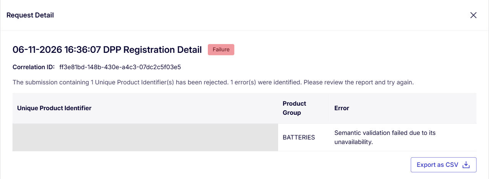

# ppt_workspace_20261113_110338

- Source: `ppt_workspace_20261113_110338.pptx`
- Total slides: 13

## Slide 1

护照模型V3.4VS官方语义库V1.0.0对比说明

## Slide 2

变更信息汇总

南京复创

南京复创

南京复创

南京复创

| 变化类别 | 项数 | 具体数据项 |
| --- | --- | --- |
| 新增数据项 | 13 | 参考标准/内容规范、分类收集点信息、回收接收点信息、再使用准备设施信息、梯次利用准备设施信息、废电池处理设施信息、废电池处理安全说明、额定容量、功率、往返能效、内阻、参考条件下预期循环寿命、空闲状态温度范围测试 |
| 填写格式调整项 | 19 | 经济运营商信息、制造商信息、生产地点、标识说明、检测报告、正极、负极、电极液组成、有害物质信息、拆卸指南、终端用户预防电池报废指南、终端用户分类回收指南、荷电状态、温度信息、最低电压、最高电压、标称电压、允许最大电池功率、预期使用寿命（年）、电池护照状态、质保期 |
| 关于是否必填要求的变更项 | 9 | 剩余容量、剩余功率、事故信息、经济运营商信息、荷电状态、温度信息、质保期、当前完全循环次数、循环寿命测试放电C率 |
| 数据拆分及合并 | 4 | 零部件编号、备件来源联系方式→零部件编号及备件来源联系方式 当前完全循环次数→充电循环次数、放电循环次数 循环寿命测试C率 →循环寿命测试充电C率、循环寿命测试放电C率 |
| 27/2/18暂不生效数据项 | 13 | 碳足迹标签、每功能单元电池碳足迹、原材料获取与预处理阶段碳足迹、核心生产阶段碳足迹、分销阶段碳足迹、退役与回收阶段碳足迹、碳足迹表现等级、碳足迹研究、电池碳足迹、尽职调查报告信息、再循环镍含量、再循环钴含量、再循环锂含量、再循环铅含量 |
| 删除数据项 | 13 | 经济运营商唯一标识符、工厂唯一标识符、制造商唯一标识符、投入使用日期、尽职调查报告信息、第三方供应链保证、供应链指数、废旧电池回收利用指南、认证可用电量、剩余可用电量、初始自放电率、当前自放电率、深度放电事件次数、过量充电次数 |

南京复创

南京复创

南京复创

南京复创

南京复创

南京复创

南京复创

南京复创

南京复创

南京复创

## Slide 3

新增数据项

| 官方语义库1.0.0 |   |   | 变更说明 |   |
| --- | --- | --- | --- | --- |
| 数据项名称 | 电池分类 | 是否必填 M：必填 C：有条件 V：推荐/自愿 | 变更类型 | 对照表备注 |
| 参考标准/内容规范ID Content specification Ids | EV/LMT/IND | M | 语义库新增 | 语义库版本，系统默认配置 |
| 分类收集点信息 Separate Collection Points | EV/LMT/IND | M | 语义库新增 | 格式是自由文本，官方测试数据给的是个网址 |
| 回收接收点信息 Take Back Collection Points | EV/LMT/IND | M | 语义库新增 | 格式是自由文本 |
| 再使用准备设施信息Preparation For Reuse Facilities | EV/LMT/IND | M | 语义库新增 | 格式是自由文本 |
| 梯次利用准备设施信息Preparation For Repurposing Facilities | EV/LMT/IND | M | 语义库新增 | 格式是自由文本 |
| 废电池处理设施信息 Waste Battery Treatment Facilities | EV/LMT/IND | M | 语义库新增 | 格式是自由文本 |
| 废电池处理安全说明 Waste Battery Safety Instructions | EV/LMT/IND | M | 语义库新增 | 格式是自由文本 |
| 额定容量 Rated capacity | EV/LMT/IND | M(EV/LMT/IND-可充电电池) | 语义库新增 | 动态值，电池状态变化时更新 |
| 功率 Power Capability | EV/LMT/IND | M(EV/LMT/IND-可充电电池) | 语义库新增 | 动态值，电池状态变化时更新 |
| 往返能效Where applicable, energy round trip efficiency [%] | EV/LMT/IND | V(如适用) | 语义库新增 | 动态值，电池状态变化时更新 |
| 内阻 internal Resistance | EV/LMT/IND | M(EV/LMT) V(IND-可充电电池) | 语义库新增 | 动态值，电池状态变化时更新 |
| 参考条件下预期循环寿命 expected Lifetime Cycles Rest | EV/LMT/IND | M(EV/LMT/IND仅适用于可用循环次数表达寿命的可充电电池) | 语义库新增 | 动态值，电池状态变化时更新 |
| 空闲状态温度范围测试 Not in use temperature range test | EV/LMT/IND | M | 语义库新增 | 格式是自由文本 |

南京复创

南京复创

南京复创

南京复创

南京复创

南京复创

南京复创

南京复创

南京复创

南京复创

南京复创

南京复创

南京复创

南京复创

## Slide 4

填写格式调整项

| 护照模型V3.4 |   |   | 官方语义库1.0.0 |   |   | 变更说明 |
| --- | --- | --- | --- | --- | --- | --- |
| 数据项名称 | 电池分类 | 是否必填 M：必填 R：推荐/自愿 | 数据项名称 | 电池分类 | 是否必填 M：必填 C：有条件 V：推荐/自愿 | 对照表备注 |
| 经济运营商信息 Economic operator information | EV/LMT/BESS/IND | R | 护照登记方/责任方身份（经济运营商） registrantIdentity | EV/LMT/IND | M | 仅名称 |
| 制造商信息 Manufacturer information | EV/LMT/BESS/IND | M | 制造商信息 Manufacturer information | EV/LMT/IND | M | 名称（必填）、注册商标/注册商号（选填）；联系地址（必填）；网址、邮箱（选填） |
| 生产地点 Manufacturing place | EV/LMT/BESS/IND | M | 生产地点 Manufacturing place | EV/LMT/IND | M | 格式：town/region（二选一）, country/jurisdiction（必填） |
| 标识说明 Meaning of labels and symbols | EV/LMT/BESS/IND | M | 标识说明 Battery Label Symbol Meaning | EV/LMT/IND | M | 对所有出现在电池产品上的标签和标识符号的核心含义 |
| 检测报告 Results of test reports proving compliance | EV/LMT/BESS/IND | M | 合规测试报告结果 Compliance Test Report Results | EV/LMT/IND | M | 上传1份文件 |
| 正极、负极、电极液组成 Materials used in cathode, anode and electrolyte | EV/LMT/BESS/IND | M | 详细组成 detailedComposition | EV/LMT/IND | M | 名称 |
| 有害物质信息 hazardous substances | EV/LMT/BESS/IND | M | 有害物质 Hazardous substances | EV/LMT/IND | M | 填名称 |
| 拆卸指南 Dismantling information: Manuals for the removal and the disassembly of the battery pack | EV/LMT/BESS/IND | M | 拆卸指南 Dismantling information: | EV/LMT/IND | M | 上传1份文件 |
| 终端用户预防电池报废指南 Information on the role of end-users in contributing to waste prevention | EV/LMT/BESS/IND | M | 终端用户预防电池报废指南 End User Role In Waste Prevention | EV/LMT/IND | M | 上传文档改为填写自由文本 |
| 终端用户分类回收指南 Information on the role of end-users in contributing to the separate collection of waste batteries | EV/LMT/BESS/IND | M | 终端用户分类回收指南 End User Role In Separate Collection | EV/LMT/IND | M | 上传文档改为填写自由文本 |
| 荷电状态 State of Charge (SoC) | EV/LMT/BESS/IND | R | 荷电状态 State of Charge (SoC) | EV/LMT/IND | M | 电池使用后适用：直方图，% |
| 温度信息Temperature information | EV/LMT/BESS/IND | R | 温度信息 Temperature information | EV/LMT/IND | M | 电池使用后适用：直方图，% |
| 最低电压 Minimum voltage | EV/LMT/BESS/IND | M | 最低电压 Minimum voltage | EV/LMT/IND | M | 和温度相关的话，附带温度 |
| 最高电压 Maximum voltage | EV/LMT/BESS/IND | M | 最高电压 Maximum voltage | EV/LMT/IND | M | 和温度相关的话，附带温度 |
| 标称电压 Nominal voltage | EV/LMT/BESS/IND | M | 标称电压 Nominal voltage | EV/LMT/IND | M | 和温度相关的话，附带温度 |
| 允许最大电池功率 Maximum permitted battery power | EV/LMT/BESS/IND | M | 允许最大电池功率 Power limits | EV/LMT/IND | M | 和温度相关的话，附带温度范围 |
| 预期使用寿命（年） Expected lifetime in calendar years | EV/LMT/BESS/IND | M | 预期使用寿命（年） Expected lifetime in calendar years | EV/LMT/IND | M(EV/LMT/IND-可充电电池) | 动态值，状态变化时更新 |
| 电池护照状态 DPP Status | EV/LMT/BESS/IND | M | 电池护照状态 DPP Status | EV/LMT/IND | M | 枚举值变化：valid、invalid |
| 质保期 Warranty period of the battery | EV/LMT/BESS/IND | R | 质保期 Commercial Warranty Period | EV/LMT/IND | 如适用（如果提供商业保修） | 单位是月 |

南京复创

南京复创

南京复创

南京复创

南京复创

南京复创

南京复创

南京复创

南京复创

南京复创

南京复创

南京复创

南京复创

南京复创

## Slide 5

关于是否必填要求的变更项

| 护照模型V3.4 |   |   | 官方语义库1.0.0 |   |   | 变更说明 |
| --- | --- | --- | --- | --- | --- | --- |
| 数据项名称 | 电池分类 | 是否必填 M：必填 R：推荐/自愿 | 数据项名称 | 电池分类 | 是否必填 M：必填 C：有条件 V：推荐/自愿 | 对照表备注 |
| 剩余容量 Remaining capacity | EV/LMT/BESS/IND | M(LMT/BESS) R(EV/IND) | 剩余容量 Remaining capacity | LMT/IND | M(LMT/IND-BESS with BMS) | 仅针对LMT和IND-BESS with BMS |
| 剩余功率 Remaining power capability | EV/LMT/BESS/IND | M(LMT/BESS) R(EV/IND) | 剩余功率 Remaining power capability | LMT/IND | M(LMT/IND-BESS with BMS) | 仅针对LMT和IND-BESS with BMS |
| 事故信息 Information on accidents | EV/LMT/BESS/IND | R | 负面事件 Negative events | EV/LMT/IND | M | 改为必填 |
| 经济运营商信息 Economic operator information | EV/LMT/BESS/IND | R | 护照登记方/责任方身份（经济运营商） registrantIdentity | EV/LMT/IND | M | 仅名称 |
| 荷电状态 State of Charge (SoC) | EV/LMT/BESS/IND | R | 荷电状态 State of Charge (SoC) | EV/LMT/IND | M | 电池使用后适用：直方图，% |
| 温度信息Temperature information | EV/LMT/BESS/IND | R | 温度信息 Temperature information | EV/LMT/IND | M | 电池使用后适用：直方图，% |
| 质保期 Warranty period of the battery | EV/LMT/BESS/IND | R | 质保期 Commercial Warranty Period | EV/LMT/IND | 如适用（如果提供商业保修） | 单位是月 |
| 当前完全循环次数 Number of full charging and discharging cycles | EV/LMT/BESS/IND | R | 充电循环次数 number Of Charging Cycles | EV/LMT/IND | M | 电池开始使用后适用 |
|   |   |   | 放电循环次数 number Of Discharging Cycles | EV/LMT/IND | M | 电池开始使用后适用 |
| 循环寿命测试C率 C-rate of relevant cycle-life test | EV/LMT/BESS/IND | M | 循环寿命测试充电C率 Cycle Life Charge C-Rate | EV/LMT/IND | M(EV/LMT/IND仅适用于可用循环次数表达寿命的部分电池) | 未变化 |
|   |   |   | 循环寿命测试放电C率 Cycle Life Discharge C-Rate | EV/LMT/IND | V | 改为选填 |

南京复创

南京复创

南京复创

南京复创

南京复创

南京复创

南京复创

南京复创

南京复创

南京复创

南京复创

南京复创

南京复创

南京复创

## Slide 6

数据拆分及合并

南京复创

| 护照模型V3.4 |   |   | 官方语义库1.0.0 |   |   | 变更说明 |   |
| --- | --- | --- | --- | --- | --- | --- | --- |
| 数据项名称 | 电池分类 | 是否必填 M：必填 R：推荐/自愿 | 数据项名称 | 电池分类 | 是否必填 M：必填 C：有条件 V：推荐/自愿 | 变更类型 | 对照表备注 |
| 零部件编号 Part numbers for components | EV/LMT/BESS/IND | M | 零部件编号及备件来源联系方式 Spare Part Replacement Details | EV/LMT/IND | M | 数据合并 | 上传1份文档 |
| 备件来源信息 Information on sources of spare parts | EV/LMT/BESS/IND | M |   |   |   |   |   |
| 当前完全循环次数 Number of full charging and discharging cycles | EV/LMT/BESS/IND | R | 充电循环次数 number Of Charging Cycles | EV/LMT/IND | M | 数据拆分 | 电池开始使用后适用 |
|   |   |   | 放电循环次数 number Of Discharging Cycles | EV/LMT/IND | M | 数据拆分 | 电池开始使用后适用 |
| 循环寿命测试C率 C-rate of relevant cycle-life test | EV/LMT/BESS/IND | M | 循环寿命测试充电C率 Cycle Life Charge C-Rate | EV/LMT/IND | M(EV/LMT/IND仅适用于可用循环次数表达寿命的部分电池) | 数据拆分 |   |
|   |   |   | 循环寿命测试放电C率 Cycle Life Discharge C-Rate | EV/LMT/IND | V | 数据拆分 | 放电C率是可选 |

南京复创

南京复创

南京复创

南京复创

南京复创

南京复创

南京复创

南京复创

南京复创

南京复创

南京复创

南京复创

南京复创

## Slide 7

27/2/18暂不生效数据项

| 护照模型V3.4 |   |   |
| --- | --- | --- |
| 数据项名称 | 电池分类 | 是否必填 M：必填 R：推荐/自愿 |
| 碳足迹标签 Carbon Footprint label | EV/LMT/BESS/IND | M |
| 每功能单元电池碳足迹 Battery carbon footprint per Functional Unit | EV/LMT/BESS/IND | M |
| 原材料获取与预处理阶段碳足迹 Contribution of raw material acquisition and pre-processing lifecycle stage | EV/LMT/BESS/IND | M |
| 核心生产阶段碳足迹 Contribution of main product production lifecycle stage | EV/LMT/BESS/IND | M |
| 分销阶段碳足迹 Contribution of distribution lifecycle stage | EV/LMT/BESS/IND | M |
| 退役与回收阶段碳足迹 Contribution of end of life and recycling lifecycle stage | EV/LMT/BESS/IND | M |
| 碳足迹表现等级 Carbon footprint performance class | EV/LMT/BESS/IND | M |
| 碳足迹研究 Web link to public carbon footprint study | EV/LMT/BESS/IND | M |
| 电池碳足迹 Absolute battery carbon footprint | EV/LMT/BESS/IND | R |

南京复创

南京复创

南京复创

南京复创

| 护照模型V3.4 |   |   |
| --- | --- | --- |
| 数据项名称 | 电池分类 | 是否必填 M：必填 R：推荐/自愿 |
| 尽职调查报告信息 Information of due diligence report | EV/LMT/BESS/IND | M |
| 再循环镍含量 Nickel recycled content share | EV/LMT/BESS/IND | M |
| 再循环钴含量 Cobalt recycled content share | EV/LMT/BESS/IND | M |
| 再循环锂含量 Lithium recycled content share | EV/LMT/BESS/IND | M |
| 再循环铅含量 Lead recycled content share | EV/LMT/BESS/IND | M |

南京复创

南京复创

南京复创

南京复创

南京复创

南京复创

南京复创

南京复创

南京复创

南京复创

## Slide 8

删除数据项

南京复创

南京复创

南京复创

南京复创

| 护照模型V3.4 |   |   |
| --- | --- | --- |
| 数据项名称 | 电池分类 | 是否必填 M：必填 R：推荐/自愿 |
| 第三方供应链保证 Third party assurances of recognised schemes | EV/LMT/BESS/IND | R |
| 供应链指数 Supply chain indices | EV/LMT/BESS/IND | R |
| 废旧电池回收利用指南 Information on battery collection, preparation for second life and on treatment at end of life | EV/LMT/BESS/IND | M |
| 认证可用电量 Certified usable battery energy | EV | R |
| 剩余可用电量 Remaining usable battery energy | EV | R |
| 初始自放电率 Initial self-discharge rate | LMT/BESS | R |
| 当前自放电率 Current self-discharge rate | LMT/BESS | R |
| 深度放电事件次数 Number of deep discharge events | EV/LMT/BESS/IND | M(LMT/BESS) R(EV/IND) |
| 过量充电次数 Number of overcharge events | EV/LMT/BESS/IND | R |

| 护照模型V3.4 |   |   |
| --- | --- | --- |
| 数据项名称 | 电池分类 | 是否必填 M：必填 R：推荐/自愿 |
| 经济运营商唯一标识符 Unique economic operator identifier | EV/LMT/BESS/IND | M |
| 工厂唯一标识符 Unique facility identifier | EV/LMT/BESS/IND | M |
| 制造商唯一标识符 Unique manufacturer identifier | EV/LMT/BESS/IND | M |
| 投入使用日期 Date of putting the battery into service | EV/LMT/BESS/IND | M(LMT/BESS) R(EV/IND) |

南京复创

南京复创

南京复创

南京复创

南京复创

南京复创

南京复创

南京复创

南京复创

南京复创

## Slide 9

官方规范已发布，完整联调条件仍待确认

开发依据已具备，完整联调仍待确认。

已发布的开发依据｜2026.10.30

内部测试记录｜2026.11.06

鉴权链路尚待完成验证

接口文档与 OpenAPI

Token地址GET探测返回404；
正式POST取Token待服务账号与凭据具备后验证。

认证与Token、注册提交、幂等重试，
以及任务状态和逐项结果查询。

在线语义校验当次不可用

语义模型 1.0.0

覆盖EV、LMT、IND的字段结构、类型、
必填、枚举及公开／受限访问视图。

校验资源与测试样例

JSON Schema、SHACL、JSON-LD，
可用于构建本地校验与回归用例。

正式环境：接收0条、拒绝1条；未完成登记。

当前完整端到端联调尚未完成，具体可联调时间以官方后续通知为准。

来源：欧盟官方资源页（2026.10.30）；《成果报告V1.3》《注册认证指南V1.2》，2026.11.06测试。
官方资料：single-market-economy.ec.europa.eu/single-market/digital-product-passport/resources-documentation_en

## Slide 10

当前可推进：完善系统，完成联调前准备

以官方接口与语义规范为基线，先完成本地开发和验证，再进入欧盟端到端联调。

| 工作方向 | 当前可开展工作 | 准备成果 |
| --- | --- | --- |
| 模型与系统适配 | 对齐字段、类型、必填、枚举、单位、多语言及权限；完善录入、动态更新规则和业务数据接入。 | 工程字段映射与模型 |
| 欧盟接口开发 | 开发私钥签名、Token申请、注册提交及幂等重试；实现任务查询，通过Mock验证调用与异常处理。 | 欧盟接口适配模块；配置及联调用例 |
| 本地模型校验 | 执行JSON Schema结构校验与SHACL语义约束校验；覆盖三类电池的正向样例和负向校验用例。 | 校验功能、样例及报告 |
| UPI与试点数据 | 准备HTTPS护照服务、匿名公开及授权受限视图；实现欧盟回读令牌验签与授权，准备单条EV数据。 | UPI与访问控制 |

联调启动条件：服务账号及凭据、Token POST、UPI回读及官方在线语义校验具备。
先完成单条EV护照端到端验证，再扩展类别与批量注册。

依据：官方API、Service Account、Self-Hosted Authentication及Semantic Data指南，结合上汽当前准备任务整理。
范围：上汽业务系统→护照平台数据接入，与护照平台→欧盟注册中心接口开发分别推进。

## Slide 11

模型4.0实施与落地

从法规要求、工程设计到功能上线与数据割接，推进七个实施步骤。

01

02

03

04

法规4.0输出

法规4.0用户宣贯

工程化4.0输出

系统影响面评估

形成法规模型
明确字段要求

对齐字段含义、适用规则
与使用方式

形成工程字段、数据结构
与实施规则

实体改动、API改动
护照编辑器改动
二维码落地页改动

05

06

07

PRD输出

功能上线

数据割接

明确功能需求、交互流程
与改造范围

完成相关功能开发
验证与发布

手动补数据
系统割接

实施路径：法规要求对齐 → 工程化设计 → 系统改造 → 上线与数据割接

## Slide 12

工程化4.0落地实施步骤

围绕数据录入、护照注册、数据展示、欧盟交互与数据割接，推进五个实施环节。

API改动

护照编辑器改动

实体改动

01

数据录入环节

变更功能

护照状态机改动

期初数据导入

注册模块

自动化逻辑

02

护照注册

Token逻辑

EU Registry凭证管理

03

数据展示环节

二维码展示页改动

04

欧盟注册中心交互

语义模型1.0转换逻辑

JTC24接口改动

05

数据割接策略

手动补数据

系统割接方案

## Slide 13

下一步计划

| 序号 | 关键事项 | 责任人 | 完成时间 |
| --- | --- | --- | --- |
| 1 | 护照模型V4.0输出：汇总前序对齐与验证结果，正式发布护照模型V4.0版本 | 孔瑞霞 | 11.10 |
| 2 | 工程化护照模型V4.0输出 | 宁蒙昌 | 11.12 |
| 3 | 变化数据项责任归属确认：根据护照模型V4.0和上汽增补确认变化项数据责任归属，完善护照数据项并同步调整业务蓝图 | 孙波 | 11.18 |
| 4 | 系统调整优化：按确认后的模型变更，对护照系统数据模型、录入界面及校验规则进行适配调整与优化 | 段素栋 | 11.30 |
| 5 | 数据收集Deadline：明确各数据项数据收集的截止时间节点，制定收集计划并跟踪落实进度 | 各业务部门 | 12.04 |
| 6 | 输出体系流程文件初版 | 孙波 | 11.30 |
| 7 | API接口对接：开发并联调上汽业务系统与护照平台的API接口，实现关键数据自动采集与同步 | 段素栋 | 预计12.30 |
| 8 | 试点护照完整认证：试点电池产品，完成一个SN的测试环境注册和NB机构最终认证（包含护照数据项完整性和系统合规性认证） | NB机构 | 27.1.15 |
| 9 | 电池护照批量正式注册 | 项目组 | 27.1.20 |
| 10 | 输出项目最终交付物，包括最终版电池护照模型表、业务蓝图最终版、体系流程文件终稿、项目白皮书终稿、试点护照认证报告、项目验收报告。 | 孙波 | 27.02 |
