# 欧盟数字产品护照注册中心：接口、字段、系统与角色交互全量梳理

> 核心来源：《Commission Implementing Regulation (EU) 2026/1778》（2026-07-16，通过本目录 PDF 原文梳理）。  
> 服务商补充法源：[Regulation (EU) 2024/1781 官方英文文本](https://eur-lex.europa.eu/eli/reg/2024/1781/oj/eng)，重点为 Articles 2(32)、10(4)、11、27(1)(c)、29(2)(c)。  
> 梳理范围：实施条例正文 Article 1–24，并以序言说明辅助解释；服务商职责专章同时追溯其直接引用的上位条例。  
> 版本：v1.1（服务商主视角），2026-07-20。

> 标识符专题证据链：[电池护照唯一标识符与电池唯一标识符法规依据.md](电池护照唯一标识符与电池唯一标识符法规依据.md)。该专题严格区分经济运营者赋予的电池唯一标识与 Commission 注册中心生成的唯一登记标识，并单列海关适用边界。

## 1. 阅读说明与结论边界

本条例是“实施安排”，不是可直接开发的 OpenAPI/JSON Schema。原文明确了接口能力、参与方、校验项、必存数据、责任和保留期限，但**没有**规定 URL、HTTP 方法、请求/响应 JSON 名称、数据类型、错误码、分页、幂等机制、固定注册状态枚举等协议细节。

本文采用三类确定性标记：

| 标记 | 含义 |
|---|---|
| **明确** | 条例直接规定该接口、字段或行为 |
| **条件** | 仅在适用的授权法案、其他欧盟法或产品场景要求时出现 |
| **待定义** | 实施必需或合理推导，但本条例未给出契约；不能宣称为法规字段 |

“DPP”指 digital product passport（数字产品护照）；“注册中心”指 Commission 管理的 DPP Registry。

本文以 **DPP 服务提供商**为重点角色。服务商不是 Commission 注册中心本身，也不是普通云存储的同义词；上位条例将其定义为：由将产品投放市场或投入使用的经济运营者授权、处理该产品 DPP 数据并向有权主体提供数据的**独立第三方自然人或法人**（Regulation (EU) 2024/1781 Article 2(32)）。

## 2. 适用产品与法律边界

| 范围 | 产品 | 法源 | 注册粒度来源 |
|---|---|---|---|
| A | Regulation (EU) 2024/1781 授权法案覆盖产品 | Article 1(1)(a) | 适用授权法案：model / batch / item |
| B | 电池 | Article 1(1)(b)；Regulation (EU) 2023/1542 Article 77 | 相应欧盟法 |
| C | 建筑产品 | Article 1(1)(c)；Regulation (EU) 2024/3110 Article 76 | 相应欧盟法 |
| D | 玩具 | Article 1(1)(d)；Regulation (EU) 2025/2509 Article 19 | 相应欧盟法 |
| E | 洗涤剂和终端用户表面活性剂 | Article 1(1)(e)；Regulation (EU) 2026/405 Article 21 | 相应欧盟法 |
| F | 其他被欧盟法要求使用并登记 DPP 的产品 | Article 1(1)(f) | 相应欧盟法 |

重要边界：本条例只列出跨产品的注册中心字段。**产品护照内部的产品属性全集**必须从各产品授权法案/产品法及语义库的数据模型继续补充，不能从本条例单独得出（Articles 8(7)、11、12）。

## 3. 系统全景

### 3.1 注册中心法定组成

| 系统/组件 ID | 系统或组件 | 职责 | 主要使用者 | 来源 |
|---|---|---|---|---|
| SYS-01 | 安全网站/用户界面 | 访问注册中心、登记 DPP、接收结果、获取登记证明 | 经济运营者、价值链参与者、国家主管机关、海关 | Article 3(a), 8(6), 9(4) |
| SYS-02 | DPP API | 登记 DPP、从注册中心接收信息、获取登记证明 | 经验证的登记主体及其系统 | Article 3(b), 8(6), 8(10), 9(4) |
| SYS-03 | 验证平台 | 确认/验证 DPP 的存在性与完整性；注册时自动执行规定检查 | 注册中心内部、登记主体 | Article 3(c), 8(7) |
| SYS-04 | 唯一登记标识生成方案 | 生成唯一、持久的 registration identifier | 注册中心内部 | Article 3(d), 8(8) |
| SYS-05 | 注册数据存储组件 | 至少保存唯一标识、适用时的商品编码及 Article 8 注册数据 | Commission、获授权用户 | Article 3(e), 8(8)–(9) |
| SYS-06 | 已验证 DPP 服务提供商名单 | 保存注册中心内已验证服务提供商参考清单 | 注册中心、登记/校验链路 | Article 3(f) |
| SYS-07 | 语义库 | 权威、机器可读的数据模型、语义定义、词汇表与检索 API | 所有人、外部系统、验证平台 | Articles 3(g), 11, 12 |
| SYS-08 | 日志系统 | 完整、准确、可靠审计轨迹；保存认证、修改、管理、交换日志 | Commission、主管机关、海关 | Articles 3(h), 14 |
| SYS-09 | 用户识别与授权方案 | 身份核验、认证、用户档案和权限管理 | 所有需登录角色 | Articles 3(i), 4–7 |
| EXT-01 | **DPP 服务提供商（本文主视角）** | 作为独立第三方托管/处理 DPP 及最新备份，向有权主体提供数据，保障可用性、访问控制、互操作、安全、完整性与业务连续性；供注册中心读取/校验 | 经济运营者、价值链参与者、注册中心、各类有权访问者 | 2026/1778 Recital 3, Articles 3(f), 8(7)(e), 8(9)(c)；2024/1781 Articles 2(32), 10(4), 11 |
| EXT-02 | eIDAS/合格信任服务 | 电子签名、电子印章、属性证明、时间戳等身份/可信服务 | 自然人、法人、Commission | Articles 4, 5, 9 |
| EXT-03 | 其他欧盟信息系统（如 EPREL） | 等效身份核验复用，避免重复验证 | 经济运营者、价值链参与者、注册中心 | Articles 4(5), 5(5)；Recital 11 |
| EXT-04 | 成员国信息系统/国家互联组件 | 与注册中心互联；由成员国建设、维护、托管并确保安全 | 国家主管机关、海关、成员国 | Article 22 |
| EXT-05 | Commission 内相关服务 | 接收注册中心数据，用于其他欧盟立法措施 | Commission | Article 21(3) |
| EXT-06 | 技术支持/自动支持工具 | 提供帮助台；2029-02 前提供全年 24 小时自动工具 | 经济运营者、价值链、主管机关、海关 | Article 13 |

### 3.2 系统上下文图

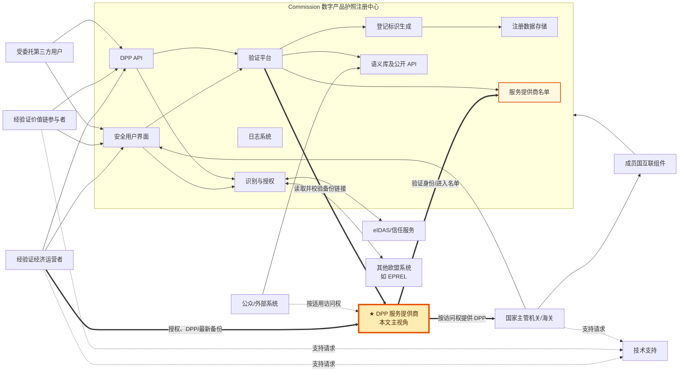

## 4. 角色、权限与责任

### 4.1 角色清单

| 角色 ID | 角色 | 准入/授权 | 允许或要求的主要动作 | 主要责任 | 来源 |
|---|---|---|---|---|---|
| R-01 | 自然人独资经济运营者 | 按是否须设立于欧盟提交规定身份凭证；验证最长 3 年或至电子身份手段先到期 | 登记 DPP、修改其 Article 8 数据、管理档案、委托第三方、生成证明、转移 DPP | 登记数据准确完整且持续更新；保护自身系统和凭证；作为其提交数据的控制者 | Articles 4, 6, 6a, 8–10, 19 |
| R-02 | 法人经济运营者 | 合格电子印章/属性证明验证身份及适用时的设立信息；有效期规则同上 | 同 R-01 | 同 R-01 | Articles 4, 6, 6a, 8–10, 19 |
| R-03 | 自然人独资价值链参与者 | Article 5 身份核验；验证最长 3 年或至身份手段先到期 | 仅在相关欧盟法规定时执行登记/修改等动作；管理档案、委托、接受转移 | 保护系统/凭证；对其上传数据负责并作为控制者 | Articles 5, 6, 6a, 20 |
| R-04 | 法人价值链参与者 | Article 5 身份及适用时的设立核验 | 同 R-03 | 同 R-03 | Articles 5, 6, 6a, 20 |
| R-05 | 受委托第三方用户 | 按 Article 5 完成价值链参与者验证；获运营者/价值链参与者委派权限 | 代表委托方执行相应动作 | 委托方仍承担全部合规责任 | Articles 6(1), 8(2), 19(4), 20(1) |
| R-06 | **DPP 服务提供商（重点）** | 独立第三方；由经济运营者授权；需要访问注册中心时按价值链参与者核验，并进入已验证服务商名单 | 存储/处理 DPP、托管最新备份、向有权主体提供数据、配合注册校验；获特别授权且验证后可代表运营者登记 | 保障法定期限内可用、互操作与无锁定、权限隔离、认证/可靠性/完整性、安全/隐私/防欺诈；未经特定约定不得超范围出售、复用或处理数据 | 2026/1778 Articles 3(f), 5, 8(7)(e), 8(9)(c), 19(4)；2024/1781 Articles 2(32), 10(4), 11, 27(1)(c), 29(2)(c) |
| R-07 | 成员国指定国家管理员 | 由成员国最迟 2027-02-18 指定并通知 Commission | 作为单一联系点；向相关国家机关委派访问权 | 成员国对委派安全、完整性、机密性负责 | Article 7(1)–(3) |
| R-08 | 国家主管机关 | 国家管理员授权；可在本机关内继续管理权限 | 按欧盟/合规国内法履职；在事件/审计/抽查中请求相关日志 | 依法处理数据；成员国控制范围内撤权 | Articles 7(4), 14(4), 21(3), 22 |
| R-09 | 市场监管机关 | 属主管机关并获授权 | 实质合规检查；按请求获取技术支持书面交流；请求相关日志 | DPP 数据实质正确性校验不由自动验证替代 | Recital 16；Articles 13(2), 14(4) |
| R-10 | 海关机关 | 由国家授权体系授予访问权 | 履行海关监管职责；在事件/审计/抽查中请求相关日志 | 依法、安全使用注册中心数据 | Articles 7, 13, 14, 22 |
| R-11 | 成员国 | 法定主体 | 指定管理员、建设互联组件、处理数据、通知组件变更 | 国家组件所有者；负责安全、维护、访问管理和其控制范围内数据处理 | Articles 7, 22 |
| R-12 | European Commission | 法定所有者/管理者 | 开发、托管、维护、监控；核验、生成标识/证明；运行语义库、日志、帮助台；对外传输数据 | 注册中心安全合规；其处理范围内为控制者 | Articles 8–18, 21 |
| R-13 | 任何用户/公众外部系统 | 无偿访问公开语义库 API | 读取、搜索、检索语义定义与数据结构 | 遵守防滥用要求 | Article 12(5)–(7), 17 |
| R-14 | Commission 内相关服务 | 按 Commission 内部授权 | 接收注册中心数据，用于市场监管、消费者保护、海关合规等欧盟法措施 | 依法处理 | Article 21(3) |

### 4.2 服务商职责主视角

#### 4.2.1 服务商法定定位

服务商处于“去中心化 DPP 数据层”，Commission 注册中心处于“标识、引用、验证和监管层”。服务商可以存储或处理完整 DPP；注册中心至少保存唯一标识、适用商品编码、服务商引用和登记证据。二者不能混为同一系统。

| 责任域 | 服务商需要承担/支撑的事项 | 确定性 | 法源 |
|---|---|---|---|
| 独立性与授权 | 作为独立第三方，取得把产品投放市场或投入使用的经济运营者授权 | 明确 | 2024/1781 Article 2(32) |
| 主体核验 | 作为价值链参与者访问注册中心时完成 Article 5 身份核验；服务商应能被列入注册中心的已验证服务商名单 | 明确框架；名单准入字段待定义 | 2026/1778 Recital 4, Articles 3(f), 5 |
| DPP 存储/处理 | 存储 DPP，或为向有权主体提供数据而处理 DPP | 明确 | 2024/1781 Articles 2(32), 11(c) |
| 最新备份托管 | 承接经济运营者必须提供的 DPP 备份；制造商/进口商应确保服务商存有最新版本 | 明确结果 | 2024/1781 Articles 10(4), 27(1)(c), 29(2)(c) |
| 按权提供数据 | 向适用授权法案规定的有权角色提供免费、易于使用的 DPP 访问；写入/修改/更新权限也必须受控 | 明确 | 2024/1781 Articles 2(32), 11(b), 11(f) |
| 互操作与无锁定 | 支撑技术、语义、组织层端到端互操作；使用开放标准和互操作格式，避免 vendor lock-in | 明确的 DPP 系统要求，服务商承载实现 | 2024/1781 Articles 10(1)(d), 11(a) |
| 版本与关联 | 新 DPP 替换已有 DPP 时，保持新旧 DPP 的链接关系 | 明确的 DPP 系统要求，服务商承载实现 | 2024/1781 Article 11(d) |
| 长期可用/业务连续性 | 在产品授权法案规定期间持续提供 DPP；即使责任运营者破产、清算或停止在欧盟活动也不能中断 | 明确 | 2024/1781 Article 11(e) |
| 数据可信 | 确保数据认证、可靠性和完整性；注意服务商保障处理链路，不替代运营者对内容准确完整、持续更新的责任 | 明确 | 2024/1781 Article 11(g)；2026/1778 Article 19 |
| 安全、隐私、防欺诈 | DPP 的设计和运行须具备高水平安全与隐私并防止欺诈 | 明确的 DPP 系统要求，服务商承载实现 | 2024/1781 Article 11(h) |
| 数据用途限制 | 除非与经济运营者另有特定约定，不得出售、复用或超出相关存储/处理服务所必需范围处理全部或部分 DPP 数据 | **服务商直接限制** | 2024/1781 Article 11 第二款 |
| 注册中心集成 | 提供可解析备份链接；允许注册中心核验该链接；登记记录可引用服务商；配合服务商名单核验 | 明确 | 2026/1778 Articles 3(f), 8(7)(e), 8(9)(c) |
| 代登记（可选） | 只有得到运营者授权并完成 Article 5 验证时，才可作为第三方代表其执行登记动作；运营者仍承担全部合规责任 | 条件 | 2026/1778 Articles 8(2), 19(4) |
| 后续准入/认证 | Commission 可另行规定成为服务商及提供服务时的要求，并可建立认证方案 | 授权待后续法规落实 | 2024/1781 Article 11 第三款 |

#### 4.2.2 服务商职责总览图

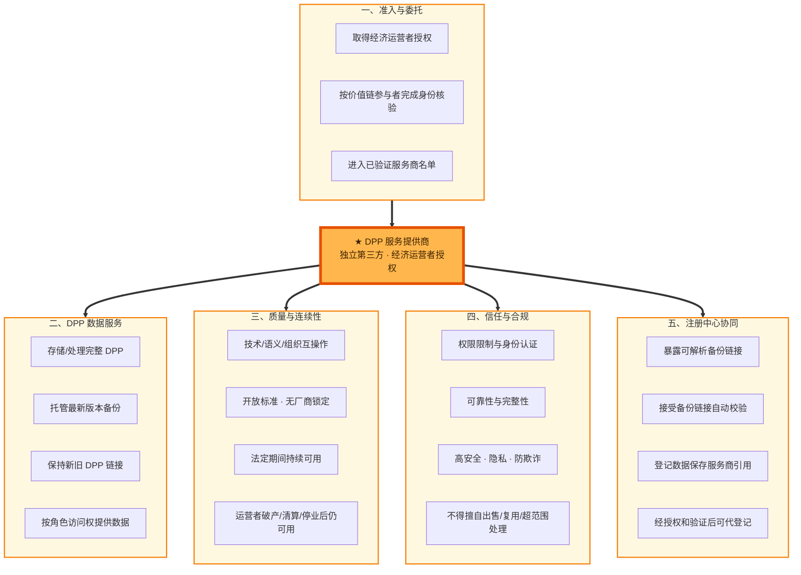

#### 4.2.3 服务商端到端交互图

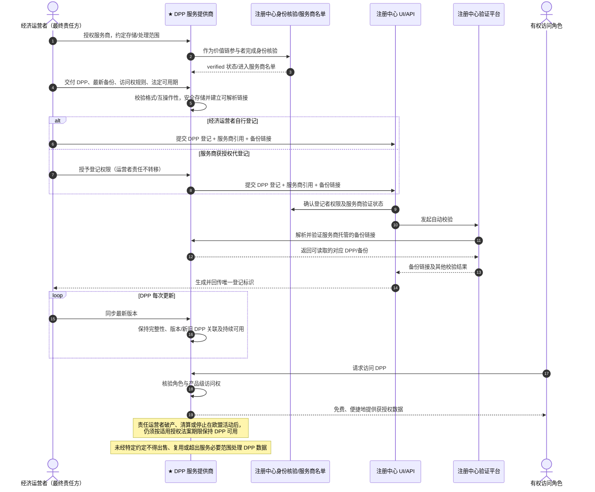

#### 4.2.4 服务商 RACI 责任矩阵

图例：`A` 最终负责（Accountable）；`R` 执行（Responsible）；`C` 协作/被咨询；`I` 被告知；`—` 无该项职责。RACI 是对法定义务的系统落地分工，不替代合同与产品授权法案。

| 活动 | 经济运营者 | DPP 服务商 | Commission 注册中心 | 主管/监管机关 | 依据/边界 |
|---|---:|---:|---:|---:|---|
| 创建 DPP、保证内容准确完整且持续更新 | A/R | C；受托时 R | I/自动校验 | 监督/实质检查 | 2024/1781 Article 9(1)；2026/1778 Articles 8, 19 |
| 存放最新 DPP 备份 | A | **R** | 仅保存引用/校验链接 | I | 2024/1781 Articles 10(4), 27(1)(c), 29(2)(c) |
| 保障 DPP 法定期限可用及经营终止后的连续性 | A | **R**（托管场景） | — | I/监督 | 2024/1781 Article 11(e) |
| 根据访问权向各角色提供 DPP 数据 | A/C | **R** | 注册中心范围内 R | 按权访问 | 2024/1781 Articles 2(32), 11(b), 11(f) |
| 互操作、开放格式、无厂商锁定 | A | **R**（服务平台） | 语义库/注册接口 R | I | 2024/1781 Articles 10(1)(d), 11(a) |
| DPP 数据认证、可靠性、完整性、安全、隐私、防欺诈 | A | **R**（服务平台） | 注册中心范围内 A/R | 监督/审计 | 2024/1781 Articles 11(g)–(h) |
| 限制 DPP 数据出售、复用和超范围处理 | C/特定约定方 | **A/R** | — | 监督 | 2024/1781 Article 11 第二款 |
| 注册 DPP | **A/R** | 获特别授权且已验证时 R | 接收、校验、生成标识 | 实质合规检查 | 2026/1778 Articles 8, 19(4) |
| 保存服务商引用、验证备份链接 | 提供登记数据 | C/R（保证链接可解析） | **A/R** | I | 2026/1778 Article 8(7)(e), 8(9)(c) |
| 产品实质合规判断 | **A** | —（除非另有专业服务约定） | 不负责实质判断 | **R** | 2026/1778 Recital 16 |

#### 4.2.5 服务商责任边界

- 服务商**不因托管 DPP 自动成为产品合规责任主体**；经济运营者仍负责登记信息准确、完整、持续更新，市场监管机关负责实质合规检查。
- 服务商**不生成注册中心的唯一登记标识或官方登记证明**；这是 Commission 注册中心的职责。
- 服务商**不能把“客户另有约定”理解为无限制数据权利**；任何特定约定仍受 GDPR、商业秘密、产品访问权和其他欧盟法约束。
- 服务商**不能只保证 URL 存活**；上位条例要求的是有权角色可访问 DPP、法定期限内持续可用、互操作、可信和安全。
- 服务商认证细则尚可能由 Commission 后续授权法案补充，因此产品设计应把准入证书、认证状态、吊销、迁移和审计证据做成可配置能力。

### 4.3 权限矩阵

图例：`✓` 明确允许/要求；`△` 取决于相关欧盟法或授权；`—` 本条例未授权。

| 动作 | 经验证经济运营者 | 经验证价值链参与者 | 第三方 | 国家管理员 | 主管机关/海关 | Commission | 公众 |
|---|---:|---:|---:|---:|---:|---:|---:|
| 创建 DPP 登记 | ✓ | △ | △ | — | — | 处理/校验 | — |
| 修改登记数据 | ✓ | △ | △ | — | △（依履职法源） | 处理/记录 | — |
| 删除登记数据 | △（权限细节未规定） | △（须有法源） | △（须有授权） | — | △（依履职法源） | 到期自动删除/处理 | — |
| 请求删除自身账号 | ✓ | ✓ | ✓ | ✓ | ✓ | 处理请求 | — |
| 转移 DPP 责任 | ✓ | △ | 按授权 | — | — | 支持转移 | — |
| 生成/下载登记证明 | ✓ | 条例未明确 | 代表经济运营者 | — | — | 生成、签章、提供 | — |
| 委派本组织用户 | ✓ | ✓ | — | — | 本机关内可再委派 | — | — |
| 委派国家机关访问权 | — | — | — | ✓ | 本机关内可再委派 | — | — |
| 请求相关审计日志 | — | — | — | 视其机关身份 | ✓（规定场景） | 提供 | — |
| 访问语义库公开 API | ✓ | ✓ | ✓ | ✓ | ✓ | 维护 | ✓ |
| 请求帮助台 | ✓ | ✓ | 视代表关系 | ✓/视机关 | ✓ | 提供 | — |

注：序言第 (1) 段提到主管机关可按适用法律更改 DPP 状态；正文没有给出专门状态接口或状态枚举，因此列为“条件”，需由相关欧盟法/国内法及后续 API 契约补齐。

## 5. 接口能力全量清单

接口 ID 是本文追踪编号，不是法规中的端点编号。

| ID | 接口/能力 | 调用方 → 提供方 | 渠道 | 关键输入 | 关键输出/效果 | 确定性 | 来源 |
|---|---|---|---|---|---|---|---|
| IF-01 | 经济运营者身份核验 | 经济运营者 → 识别授权方案/eIDAS | UI/联邦身份服务，协议待定义 | 身份、适用时设立证明、签名/印章/属性证明 | verified economic operator 状态及有效期能力 | 明确；协议待定义 | Article 4 |
| IF-02 | 价值链参与者身份核验 | 价值链参与者 → 识别授权方案/eIDAS | 同上 | 身份、适用时设立证明、签名/印章/属性证明 | verified value chain actor 状态 | 明确；协议待定义 | Article 5 |
| IF-03 | 等效欧盟系统核验复用 | 注册中心 ↔ 其他欧盟信息系统 | 系统互联，协议待定义 | 既有验证结果/等效性 | 免重复身份核验 | 条件 | Articles 4(5), 5(5) |
| IF-04 | 用户档案读取/更新 | 经验证运营者/价值链参与者 → 注册中心 | UI；API 未明确 | 档案及变更信息 | 更新后的档案 | 明确能力；字段见 FD-PROF | Article 6 |
| IF-05 | 第三方访问权委派/撤回 | 经验证运营者/价值链参与者 → 授权方案 | UI；协议待定义 | 被委派用户、权限范围 | 第三方获得/失去权限 | 条件（须有欧盟法依据） | Article 6(1) |
| IF-06 | DPP 责任转移 | 原责任主体 → 注册中心 → 新验证主体 | 未规定 | DPP 范围、受让主体、生效日期 | 自指定日期起责任转移 | 明确能力；报文待定义 | Article 6a |
| IF-07 | 国家管理员信息报送/变更通知 | 成员国 → Commission | 未规定 | 姓名、联系方式、变更 | 建立/更新单一联系点 | 明确 | Article 7(1)–(2) |
| IF-08 | 国家机关访问权委派 | 国家管理员 → 主管机关/海关 | 授权方案 | 机关/用户、权限范围 | 访问权生效 | 明确；字段待定义 | Article 7(3) |
| IF-09 | 机关内部权限再委派/管理 | 已授权国家机关 → 本机关用户 | 授权方案 | 用户、权限范围 | 访问权生效/变更/撤销 | 明确；字段待定义 | Article 7(4) |
| IF-10 | DPP 登记提交 | 相关经验证主体/受托第三方 → 注册中心 | **安全 UI 或 API** | DPP 内容/可解析位置、粒度、标识、适用商品编码/服务商/备份链接等 | 进入自动校验 | 明确 | Article 8(1)–(7) |
| IF-11 | DPP 自动校验 | 注册中心验证平台 → DPP/语义库/服务商 | 内部/系统间 | 登记提交和 DPP 内容 | 各项校验结果、成功/失败 | 明确；结果结构待定义 | Article 8(7) |
| IF-12 | 唯一登记标识生成与回传 | 注册中心 → 登记主体 | 与提交相同的 UI 或 API response | 成功校验事件 | unique persistent registration identifier | 明确 | Article 8(8), 8(10) |
| IF-13 | 登记证明生成 | 经济运营者或其第三方 → 注册中心 | UI 或 API | 一个或多个其负责的 DPP | 安全电子登记证明 | 明确 | Article 9(1)–(4) |
| IF-14 | 登记证明下载/重新生成 | 登记者 → 注册中心 | UI 或 API | 证明引用（实际标识待定义） | 合格电子印章和 Commission 时间戳保护的文档；90 天可用 | 明确；检索键待定义 | Article 9(2)–(4); Recital 17 |
| IF-15 | 登记数据修改/版本更新 | 有权主体 → 注册中心 | 渠道未明确 | 新版本登记数据 | 版本化数据、Commission 时间戳、登记状态变化、日志 | 明确能力；契约待定义 | Article 10(1)–(2) |
| IF-16 | 登记数据删除 | 有权主体/定时任务 → 注册中心 | 手工渠道未明确/自动 | 删除目标、法定保留规则 | 数据删除、状态变化、日志 | 明确行为；契约待定义 | Article 10(1), 10(3) |
| IF-17 | 用户账号删除请求 | 注册中心用户 → 注册中心 | 未规定 | 自身账号删除请求 | 账号删除流程 | 明确权利；契约待定义 | Article 10(4) |
| IF-18 | 语义定义搜索/读取/检索 | 任何用户/外部系统 → 语义库 | 搜索服务及**公开文档化 API** | 查询条件（未规定） | 机器可读语义资产、数据结构 | 明确能力；契约待发布 | Article 12(5)–(7) |
| IF-19 | 技术支持请求 | 四类用户 → Commission 帮助台/自动工具 | Commission 网站/工具 | 支持请求及书面交流 | 支持答复、工单关闭 | 明确；工单字段待定义 | Article 13 |
| IF-20 | 支持交流调阅 | 市场监管机关 → Commission | 按请求 | 已关闭支持请求范围 | 六个月内的书面交流 | 明确 | Article 13(2) |
| IF-21 | 相关日志调阅 | 主管机关/海关 → Commission | 按请求 | 疑似事件/审计/安全抽查及日志范围 | 相关日志 | 明确 | Article 14(4) |
| IF-22 | 计划维护通知发布 | Commission → 所有用户 | 注册中心公共网站 | 不可访问窗口 | 提前通知 | 明确 | Article 15(2) |
| IF-23 | 故障不可用记录查询 | 四类用户 → Commission | 按请求 | 不可用事件/时间范围 | 不可用日期、时间；至少保存 5 年 | 明确 | Article 15(4) |
| IF-24 | 恶意行为报告 | 任一发现用户 → Commission/适用时成员国 | 未规定 | 已知或合理怀疑的恶意行为 | 受理、预防/处置/缓解 | 明确义务；报文字段待定义 | Article 17 |
| IF-25 | 注册中心数据传输 | Commission → 内部相关服务/主管机关 | 系统间，协议待定义 | 履行其他欧盟法所需数据 | 供市场监管、消费者保护、海关合规等使用 | 条件 | Article 21(3) |
| IF-26 | 成员国系统互联 | 成员国组件 ↔ 注册中心 | 系统间，协议待定义 | 访问/交换数据 | 国家机关访问注册中心 | 条件 | Article 22(1)–(3) |
| IF-27 | 国家组件变更/更新通知 | 成员国 → Commission | 未规定 | 可能影响注册中心的组件变更/更新 | Commission 获知影响 | 明确 | Article 22(2) |
| IF-28 | DPP 存在性与完整性验证服务 | 用户/注册链路 → 验证平台 | 入口协议未规定 | DPP 引用/内容 | 存在性、完整性确认 | 组件能力明确；外部端点待定义 | Article 3(c) |
| IF-29 | 已验证 DPP 服务商名单查询/引用 | 注册/校验链路 → 服务商名单 | 入口协议未规定 | 服务商引用/查询条件 | 已验证服务商记录 | 数据组件明确；查询接口待定义 | Article 3(f) |
| IF-30 | 服务商授权/委托建立 | 经济运营者 → DPP 服务商 | 合同/电子授权，协议待定义 | 委托主体、产品/DPP 范围、存储/处理目的、期限、权限 | 服务商获得限定处理授权 | 法律关系明确；接口待定义 | 2024/1781 Article 2(32) |
| IF-31 | 服务商核验与名单登记 | DPP 服务商 → 注册中心 | 身份核验/名单管理入口待定义 | 服务商身份、设立证明、验证凭证、名单所需资料 | verified 状态和服务商名单记录 | 框架明确；字段待定义 | 2026/1778 Recital 4, Articles 3(f), 5 |
| IF-32 | DPP/最新备份接入 | 经济运营者 → DPP 服务商 | 服务商接口待定义 | DPP、版本、产品标识、访问权、可用期限 | 被安全存储且可解析的 DPP/备份 | 结果明确；协议待定义 | 2024/1781 Articles 10(4), 11(c), 27(1)(c) |
| IF-33 | DPP 版本同步 | 经济运营者 → DPP 服务商 | 服务商接口待定义 | 新版本 DPP、原 DPP 关联、完整性材料 | 最新备份、版本/关联更新 | DPP 要求明确；协议待定义 | 2024/1781 Article 11(d); Articles 27(1)(c), 29(2)(c) |
| IF-34 | DPP 按权解析/读取 | 有权角色 → DPP 服务商 | 开放互操作网络，协议待定义 | 数据载体/产品标识、访问者身份和权限 | 免费、便捷的获授权 DPP 数据 | 明确能力；产品级权限待定义 | 2024/1781 Articles 2(32), 10(1)(d), 11(a)–(b) |
| IF-35 | DPP 写入/修改/更新授权 | 有权价值链角色 → DPP 服务商 | 服务商接口待定义 | 身份、角色、产品级写权限、变更数据 | 授权范围内变更或拒绝 | 权限限制明确；具体角色/字段待产品法定义 | 2024/1781 Article 11(f) |
| IF-36 | 服务商备份链接验证响应 | 注册中心验证平台 → DPP 服务商 | 可解析链接/系统间接口 | 备份链接、关联 DPP | 可读取备份及链接有效性证据 | 条件明确；协议待定义 | 2026/1778 Article 8(7)(e) |
| IF-37 | 服务商退出/数据迁移 | 经济运营者/继任服务商 ↔ 原服务商 | 迁移接口待定义 | DPP 全量、版本/关系、权限、完整性材料 | 无锁定迁移并保持持续可用 | 实现推导；不得损害法定可用性 | 2024/1781 Articles 10(1)(d), 11(a), 11(e) |

### 5.1 不能从条例虚构的 API 契约

以下项目全部是后续技术规范的必填空白：base URL、endpoint path、HTTP method、认证协议和 token 格式、字段英文键名、类型/长度/正则、必填矩阵、错误码、同步/异步模式、分页与过滤、批量上限、幂等键、并发版本控制、速率限制、上传方式、DPP URI 表达、证明文件格式、电子签章容器格式、状态枚举、日志检索响应、删除/转移审批机制。

## 6. 字段全量字典

字段名为中文业务名称；除原文已有英文术语外，不伪造 JSON key。`M`=明确必需，`C`=条件必需，`G`=系统生成，`TBD`=本条例未定义是否必填或具体结构。

### 6.1 身份核验与用户档案字段

| 字段 ID | 业务字段 | 适用对象 | 要求 | 用途/规则 | 来源 |
|---|---|---|---|---|---|
| FD-ID-01 | 主体类型：自然人独资/法人 | 经济运营者、价值链参与者 | M | 决定签名或印章核验路径 | Articles 4(1)–(2), 5(1)–(2) |
| FD-ID-02 | 是否依法须设立于欧盟 | 同上 | M（判断条件） | 决定身份/设立证明组合 | Articles 4, 5 |
| FD-ID-03 | 身份证明 | 自然人及法人 | M | 通过规定可信手段提交 | Articles 4, 5 |
| FD-ID-04 | 设立证明 | 法人 | C | 须设立于欧盟时明确要求；其他情形为“where applicable” | Articles 4(2), 5(2) |
| FD-ID-05 | 合格电子签名及其合格证书 | 自然人 | 备选 M | 与高保证级 eID/电子属性证明构成法定选项 | Articles 4(1), 5(1) |
| FD-ID-06 | 高保证级电子身份识别手段 | 欧盟设立路径中的自然人 | 备选 M | assurance level “high” | Articles 4(1)(a), 5(1)(a) |
| FD-ID-07 | 电子属性证明 | 自然人/法人 | 备选 M | 须能识别主体；法人路径适用时还须证明设立 | Articles 4, 5 |
| FD-ID-08 | 合格电子印章及其合格证书 | 法人 | 备选 M | 由 eIDAS 下合格信任服务提供商签发 | Articles 4(2), 5(2) |
| FD-ID-09 | 验证状态 | 经济运营者、价值链参与者 | G | verified / 非 verified 的概念明确；技术枚举未定义 | Articles 4, 5 |
| FD-ID-10 | 验证日期 | 同上 | G/TBD | 计算最长三年有效期所必需；原文未命名字段 | Articles 4(4), 5(4) |
| FD-ID-11 | 电子身份手段到期时间 | 同上 | C/TBD | 与三年期限取先到期；原文未给格式 | Articles 4(4), 5(4) |
| FD-ID-12 | 验证有效截止时间 | 同上 | G/TBD | `min(身份手段到期, 验证日+3年)` | Articles 4(4), 5(4) |
| FD-ID-13 | 名 | 每个用户/法人法定代表 | M | 身份核验个人数据 | Article 18(1)(a) |
| FD-ID-14 | 姓 | 每个用户/法人法定代表 | M | 身份核验个人数据 | Article 18(1)(a) |
| FD-ID-15 | 法定代表身份/代表关系 | 法人场景 | C | 原文要求存法定代表姓名；代表关系结构未定义 | Article 18(1)(a) |
| FD-ID-16 | 登录凭证 | 用户 | M/C | 用户名/密码等，用于认证；具体机制未定义 | Articles 2(2), 18(1)(b) |
| FD-ID-17 | 认证令牌 | 用户/应用 | C | 成功认证会话或应用委派访问 | Articles 2(3), 18(1)(b) |
| FD-ID-18 | 邮政地址 | 经济运营者、价值链参与者用户 | M | 注册中心存储的个人数据 | Article 18(1)(c) |
| FD-ID-19 | 电子邮箱地址 | 每个用户 | M | 注册中心存储的个人数据 | Article 18(1)(d) |
| FD-ID-20 | 上传文档内嵌元数据 | 用户 | C | 仅在有助于用户识别/核验时存储 | Article 18(1)(e) |
| FD-ID-21 | 护照号码 | 自然人 | 备选 M | 与其他自然人标识符构成“例如”集合 | Article 18(2) |
| FD-ID-22 | 国民身份证号码 | 自然人 | 备选 M | 同上 | Article 18(2) |
| FD-ID-23 | 国家 eID 号码 | 自然人 | 备选 M | 同上 | Article 18(2) |
| FD-ID-24 | 民事登记号码 | 自然人 | 备选 M | 同上 | Article 18(2) |
| FD-ID-25 | 税务识别号 | 自然人 | 备选 M | 由相应成员国国家机关签发 | Article 18(2) |
| FD-ID-26 | 第三国个人标识符/身份证明文件 | 自然人 | 备选 M | 第三国识别路径 | Article 18(2) |
| FD-ID-27 | 用户角色 | 价值链参与者等 | C/TBD | repairer/refurbisher/remanufacturer/recycler/other 等，具体由适用法律定义 | Article 2(6); Recital 9 |
| FD-ID-28 | 用户档案数据变更 | 运营者、价值链参与者 | M | 有相关变化时更新，包括法定代表变化 | Article 6(4); Recital 11 |

说明：Article 18(2) 写的是自然人“还须存储个人标识符，例如……”，并不表示所列护照号、身份证号、eID、民事登记号、税号必须全部同时采集；具体最小组合需由核验规则确定。

### 6.2 权限与国家管理员字段

| 字段 ID | 业务字段 | 要求 | 规则 | 来源 |
|---|---|---|---|---|
| FD-AUTH-01 | 委托方主体 | TBD | 实现委派必需，本条例未给字段结构 | Article 6(1) |
| FD-AUTH-02 | 被委托第三方用户 | TBD | 第三方须完成相应验证 | Articles 6(1), 19(4) |
| FD-AUTH-03 | 访问权/权限范围 | TBD | 法律要求管理访问权，但未给权限编码 | Articles 6(1), 7(3)–(4) |
| FD-AUTH-04 | 权限变更类型 | TBD | 创建、变更、撤回都须进入管理日志 | Article 14(2)(c) |
| FD-AUTH-05 | 指定国家管理员姓名 | M | 成员国须报送 Commission | Article 7(2) |
| FD-AUTH-06 | 指定国家管理员联系方式 | M | 成员国须报送并通知后续变更 | Article 7(2) |
| FD-AUTH-07 | 成员国 | TBD | 作为管理员归属及委派责任边界必需，原文未命名技术字段 | Article 7 |
| FD-AUTH-08 | 获授权国家机关 | TBD | 国家管理员委派目标 | Article 7(3) |
| FD-AUTH-09 | 机关内部获授权用户 | TBD | 国家机关可进一步管理 | Article 7(4) |

### 6.3 DPP 服务商专项字段

本组包含服务商平台要管理的业务数据；`明确`表示法源直接出现该数据概念，`实施`表示为证明法定义务而需要设计、但字段名和结构仍待技术规范/合同确定。

| 字段 ID | 服务商业务字段 | 要求 | 规则 | 来源 |
|---|---|---|---|---|
| FD-SP-01 | 服务商主体身份 | 明确 | 独立第三方自然人或法人；具体唯一标识格式待定义 | 2024/1781 Article 2(32) |
| FD-SP-02 | 独立第三方属性/声明 | 明确/实施 | 服务商不得与定义要求冲突；证明方式未规定 | 2024/1781 Article 2(32) |
| FD-SP-03 | 授权经济运营者 | 明确 | 标识授权服务商处理 DPP 的责任运营者 | 2024/1781 Article 2(32) |
| FD-SP-04 | 授权/委托证据 | 明确/实施 | 至少应可证明授权关系、产品/DPP 范围、处理目的、权限和期限 | 2024/1781 Article 2(32) |
| FD-SP-05 | 服务商 verified 状态及有效期 | 明确框架 | 按价值链参与者核验；技术枚举、有效期字段沿用 Article 5 | 2026/1778 Articles 3(f), 5 |
| FD-SP-06 | 注册中心服务商名单引用 | 明确 | 用于被登记数据引用和验证平台核验；标识格式待定义 | 2026/1778 Articles 3(f), 8(9)(c) |
| FD-SP-07 | 服务范围/处理目的 | 明确/实施 | 限定为相关存储或处理服务，超范围处理受限 | 2024/1781 Articles 2(32), 11 第二款 |
| FD-SP-08 | 托管 DPP 及唯一产品标识 | 明确 | DPP 可由服务商存储，并与持久唯一产品标识关联 | 2024/1781 Articles 10(1)(a), 11(c) |
| FD-SP-09 | DPP 备份可解析链接 | 明确 | 注册时适用情况下由验证平台校验 | 2026/1778 Article 8(7)(e) |
| FD-SP-10 | 备份版本/最新版本标识 | 明确结果/实施 | 制造商和进口商必须能确保服务商保存最新版本 | 2024/1781 Articles 27(1)(c), 29(2)(c) |
| FD-SP-11 | DPP 版本完整性值/哈希 | 实施 | 用于证明返回版本未被篡改；算法由技术规范确定 | 2024/1781 Article 11(g) |
| FD-SP-12 | 原 DPP/前序版本链接 | 明确 | 新 DPP 创建时须链接原 DPP | 2024/1781 Article 11(d) |
| FD-SP-13 | 数据模型/语义版本 | 实施 | 支撑技术和语义互操作；应与注册中心语义库一致 | 2024/1781 Article 11(a)；2026/1778 Articles 11–12 |
| FD-SP-14 | 访问者身份与角色 | 明确/实施 | 决定可访问的数据范围；产品级角色由适用授权法案定义 | 2024/1781 Articles 9(2)(f), 11(b) |
| FD-SP-15 | DPP 数据访问权限 | 明确 | 读取、写入、修改、更新须按产品级访问权限制 | 2024/1781 Articles 9(2)(f)–(h), 11(f) |
| FD-SP-16 | DPP 法定可用期间/截止时间 | 明确 | 至少与具体产品预期寿命相符，最终以产品授权法案为准 | 2024/1781 Articles 9(2)(i), 11(e) |
| FD-SP-17 | 责任运营者经营状态/连续性触发 | 明确场景/实施 | 破产、清算或停止在欧盟活动不能导致 DPP 提前不可用 | 2024/1781 Article 11(e) |
| FD-SP-18 | 特定数据处理约定 | 条件明确 | 只有存在与经济运营者的特定约定时才可能超出默认必要范围；仍受其他法律限制 | 2024/1781 Article 11 第二款 |
| FD-SP-19 | 数据出售/复用/处理用途审计记录 | 实施 | 用于证明未超范围利用 DPP 数据 | 2024/1781 Article 11 第二款 |
| FD-SP-20 | 认证、可靠性、完整性证据 | 明确结果/实施 | 证据类型、签名/哈希和验证协议待定义 | 2024/1781 Article 11(g) |
| FD-SP-21 | 安全、隐私、防欺诈控制及事件记录 | 明确结果/实施 | 服务商平台须提供高水平保护；控制清单待标准/认证规则定义 | 2024/1781 Article 11(h) |
| FD-SP-22 | 服务商认证/证书状态 | 待后续法案 | Commission 可建立服务商要求与认证方案 | 2024/1781 Article 11 第三款 |
| FD-SP-23 | 迁移包/交接记录 | 实施推导 | 应包含 DPP、版本关系、权限、完整性材料，避免锁定和可用性中断 | 2024/1781 Articles 10(1)(d), 11(a), 11(e) |

### 6.4 DPP 登记请求、关联与存储字段

| 字段 ID | 业务字段 | 要求 | 规则 | 来源 |
|---|---|---|---|---|
| FD-REG-01 | DPP 内容/可读取表示 | M | Commission 提交后须读取 DPP 内容；具体传输方式/URI 字段未规定 | Article 8(7) |
| FD-REG-02 | 产品范围/产品组 | M/TBD | 用于确定适用法、模型、商品编码范围；技术字段未规定 | Articles 1, 8(7) |
| FD-REG-03 | 登记粒度 | M | model / batch / item；多法源冲突时取最细粒度 | Article 8(1)–(3) |
| FD-REG-04 | 唯一产品标识（unique product identifier） | M | 登记证明至少包含；属于 unique identifiers 范畴 | Article 9(2)(a) |
| FD-REG-05 | 项目标识/item identifier | C | item 级 DPP 对应标识；具体术语/格式由适用法和模型确定 | Article 8(3)–(4) |
| FD-REG-06 | 批次标识/batch identifier | C | item 级且存在 batch/model 设计时关联；batch 级本身亦需相应标识 | Article 8(4)–(5); Recital 14 |
| FD-REG-07 | 型号标识/model identifier | C | item 级或 batch 级且存在 model 设计时关联 | Article 8(4)–(5); Recital 14 |
| FD-REG-08 | 唯一标识集合 | C | Commission 作为注册数据存储；具体组合取决于粒度/产品法 | Article 8(9)(a) |
| FD-REG-09 | 商品编码/commodity code | C | 适用于相关产品，尤其拟进入“自由流通放行”海关程序；需验证允许范围 | Articles 1(2)(e), 3(e), 8(7)(d), 8(9)(b) |
| FD-REG-10 | DPP 服务提供商引用 | C | 存储对服务提供商的 reference | Article 8(9)(c) |
| FD-REG-11 | DPP 服务提供商备份链接 | C | 注册时在适用情况下自动验证 | Article 8(7)(e) |
| FD-REG-12 | 登记者信息 | M | Commission 存储；至少包含登记日期时间和 DPP 完整性证据 | Article 8(9)(d) |
| FD-REG-13 | 登记者主体身份/名称 | M | 证明中需体现负责登记的经验证运营者名称和身份 | Article 9(2)(c) |
| FD-REG-14 | 登记日期和时间 | M/G | 作为登记事件证据；最新版本证明需 Commission 时间戳验证 | Articles 8(9)(d), 9(2)(d) |
| FD-REG-15 | DPP 完整性证据 | M | 作为登记事件证据的一部分；算法/表示未规定 | Article 8(9)(d) |
| FD-REG-16 | 唯一、持久登记标识 | G | 成功验证后生成并存储，回传登记主体 | Article 8(8), 8(10) |
| FD-REG-17 | 登记状态 | G/TBD | 创建、修改、删除须反映状态；状态枚举未定义 | Article 10(1); Article 1(2)(g) |
| FD-REG-18 | 登记数据版本 | G/TBD | 必须支持版本化；序言说明新版本关联原登记标识 | Article 10(2); Recital 18 |
| FD-REG-19 | 更新的 Commission 时间戳 | G | 每次更新保存 | Article 10(2) |
| FD-REG-20 | 产品特定 DPP 数据属性 | C | 全部字段来自适用授权法案/其他欧盟法和语义库，不在本条例列举 | Articles 8(7)(a)–(c), 11, 12 |
| FD-REG-21 | 类型化、可解析的 DPP 间链接 | C | 语义规范须支持时使用 | Article 12(2)(a) |
| FD-REG-22 | DPP 属性与价值链证据链接 | C | 语义规范须支持时使用 | Article 12(2)(a) |

### 6.5 自动校验输入/结果字段

| 字段 ID | 校验项/结果 | 要求 | 规则 | 来源 |
|---|---|---|---|---|
| FD-VAL-01 | 语义一致性结果 | M/G | 校验必需数据存在、结构、格式、值类型、受控词汇、适用规则和可解释性 | Articles 2(12), 8(7)(a) |
| FD-VAL-02 | 注册中心强制数据与 DPP 值一致性结果 | C/G | 适用时比较 | Article 8(7)(b) |
| FD-VAL-03 | 粒度一致性结果 | M/G | 与适用法规定的 model/batch/item 核对 | Article 8(7)(c) |
| FD-VAL-04 | 商品编码有效性结果 | C/G | 与产品组允许范围核对 | Article 8(7)(d) |
| FD-VAL-05 | 服务提供商备份链接校验结果 | C/G | 适用时校验链接 | Article 8(7)(e) |
| FD-VAL-06 | 总体验证结果 | G/TBD | 成功时方可生成登记标识；失败结构/错误码未规定 | Article 8(8) |

注意：自动校验不等于产品实质合规证明；实质正确性仍由市场监管机关依据适用欧盟规则检查（Recital 16）。

### 6.6 登记证明字段

| 字段 ID | 业务字段 | 要求 | 规则 | 来源 |
|---|---|---|---|---|
| FD-POE-01 | 唯一产品标识 | M | 证明至少包含 | Article 9(2)(a) |
| FD-POE-02 | 商品编码 | C | Article 8(9)(b) 适用时包含 | Article 9(2)(b) |
| FD-POE-03 | 负责登记的经验证经济运营者名称 | M | 证明至少包含 | Article 9(2)(c) |
| FD-POE-04 | 负责登记的经验证经济运营者身份 | M | 证明至少包含；具体标识类型未规定 | Article 9(2)(c) |
| FD-POE-05 | 最新 DPP 版本登记日期和时间 | M | 由 Commission 电子时间戳验证 | Article 9(2)(d) |
| FD-POE-06 | DPP 版本哈希 | M | 对证明所对应版本的电子数据使用密码算法生成 | Articles 2(16), 9(2)(e) |
| FD-POE-07 | Commission 电子时间戳 | M/G | 纳入证明 | Article 9(2)(d), 9(3) |
| FD-POE-08 | 合格电子印章 | M/G | 保证证明 | Article 9(3) |
| FD-POE-09 | 证明生成日期 | G/TBD | 计算 90 日可用期所需，原文没有指定输出字段名称 | Article 9(4) |
| FD-POE-10 | 证明可用截止日期 | G/TBD | 生成后 90 个日历日；可重新生成 | Article 9(4); Recital 17 |

### 6.7 转移、删除与状态字段

| 字段 ID | 业务字段 | 要求 | 规则 | 来源 |
|---|---|---|---|---|
| FD-LIFE-01 | 待转移 DPP 范围 | TBD | 可为已登记 DPP；技术表达未规定 | Article 6a |
| FD-LIFE-02 | 原责任主体 | TBD | 实现责任转移所需，原文未列报文 | Article 6a |
| FD-LIFE-03 | 新责任主体 | M（业务） | 必须是经验证经济运营者或适用时经验证价值链参与者 | Article 6a |
| FD-LIFE-04 | 转移生效日期 | M | 新主体从该日期承担义务 | Article 6a |
| FD-LIFE-05 | 删除目标/范围 | TBD | 手工删除契约未定义 | Article 10(1) |
| FD-LIFE-06 | 删除原因 | TBD | 法规未规定字段，但审计实现通常需要 | —（实施推导） |
| FD-LIFE-07 | 适用 DPP 法定可用期限 | C | 适用法另有规定时按该期限保留 | Article 10(3) |
| FD-LIFE-08 | 自动删除日期 | G/TBD | 无特殊法定期限时登记后 10 年；有则与其对齐 | Article 10(3) |
| FD-LIFE-09 | 账号删除请求 | M（权利） | 用户不再负责相关活动时可请求 | Article 10(4) |

### 6.8 语义库字段

| 字段 ID | 业务字段/资产 | 要求 | 规则 | 来源 |
|---|---|---|---|---|
| FD-SEM-01 | DPP 数据属性语义含义 | M | 权威、机器可读 | Article 12(1), 12(2)(a) |
| FD-SEM-02 | 类型化、可解析链接技术规范 | C | DPP 间、DPP 属性与底层证据间 | Article 12(2)(a) |
| FD-SEM-03 | 各类产品数据模型 | M | 含格式；模型必须版本化 | Articles 11(1)–(4), 12(2)(b) |
| FD-SEM-04 | 产品数据模型元数据 | M | 须符合 DCAT-AP | Article 12(2)(c), 12(3) |
| FD-SEM-05 | 角色语义含义 | M | 来源于适用授权法案或其他欧盟法 | Article 12(2)(d) |
| FD-SEM-06 | 强制数据属性多语言标签 | M | 新引入属性也必须发布 | Article 12(2)(e), 12(4) |
| FD-SEM-07 | 强制数据属性多语言定义 | M | 新引入属性也必须发布 | Article 12(2)(e), 12(4) |
| FD-SEM-08 | 本体/ontology | C | semantic specification 可能包含 | Article 2(11) |
| FD-SEM-09 | 受控词汇 | C | semantic specification 可能包含 | Articles 2(10)–(11), 11(2) |
| FD-SEM-10 | 代码表 | C | semantic specification 可能包含 | Article 2(11) |
| FD-SEM-11 | 版本元数据 | M/C | 语义资产随版本管理 | Article 2(11); Article 11(4) |
| FD-SEM-12 | 来源/provenance 信息 | M/C | semantic specification 的组成 | Article 2(11) |

### 6.9 日志、支持、可用性与安全事件字段

条例规定日志**类别**，没有给出逐字段日志 Schema。下表将明确字段与实现必需元数据分开。

| 字段 ID | 业务字段/事件 | 要求 | 规则 | 来源 |
|---|---|---|---|---|
| FD-LOG-01 | 访问与认证事件数据 | M | 保存 6 个月 | Article 14(2)(a), 14(3)(a) |
| FD-LOG-02 | 数据修改事件数据 | M | 含上传/更新；保存整个登记存续期 | Article 14(2)(b), 14(3)(c) |
| FD-LOG-03 | 用户账号创建/变更/删除事件 | M | 行政动作；保存 5 年 | Article 14(2)(c), 14(3)(b) |
| FD-LOG-04 | 访问权与权限变更事件 | M | 行政动作；保存 5 年 | Article 14(2)(c), 14(3)(b) |
| FD-LOG-05 | 注册中心配置及其他管理动作 | M | 保存 5 年 | Article 14(2)(c), 14(3)(b) |
| FD-LOG-06 | 数据交换日志 | M | 保存 5 年 | Article 14(2)(d), 14(3)(b) |
| FD-LOG-07 | 事件日期时间 | 部分明确/TBD | 更新须有 Commission 时间戳；完整日志通用字段未单列 | Articles 10(2), 14 |
| FD-LOG-08 | 操作主体 | TBD | “by all registry users”要求可归责，但技术字段未定义 | Article 14(2) |
| FD-LOG-09 | 动作类型 | TBD | 完整审计轨迹实现所需；技术枚举未定义 | Article 14(1)–(2) |
| FD-LOG-10 | 对象/资源标识 | TBD | 完整审计轨迹实现所需；技术字段未定义 | Article 14(1) |
| FD-LOG-11 | 操作结果 | TBD | 完整、准确、可靠轨迹实现所需；技术字段未定义 | Article 14(1) |
| FD-LOG-12 | 技术支持请求 | M（记录） | 工单字段未规定 | Article 13(1) |
| FD-LOG-13 | 支持书面交流 | M（记录） | 工单关闭后保存 6 个月 | Article 13(2) |
| FD-LOG-14 | 支持请求关闭日期 | G/TBD | 计算六个月期限所需，字段格式未规定 | Article 13(2) |
| FD-LOG-15 | 不可用日期 | M | 注册受阻时记录 | Article 15(4) |
| FD-LOG-16 | 不可用时间 | M | 至少保存/可供请求 5 年 | Article 15(4) |
| FD-LOG-17 | 恶意/欺诈活动报告 | M（业务） | 用户立即报告；具体字段未定义 | Article 17 |
| FD-LOG-18 | 大规模数据下载相关活动 | C | 属不当/欺诈活动监测范围 | Articles 2(17), 17 |

## 7. 核心交互图

### 7.1 身份核验与权限生效

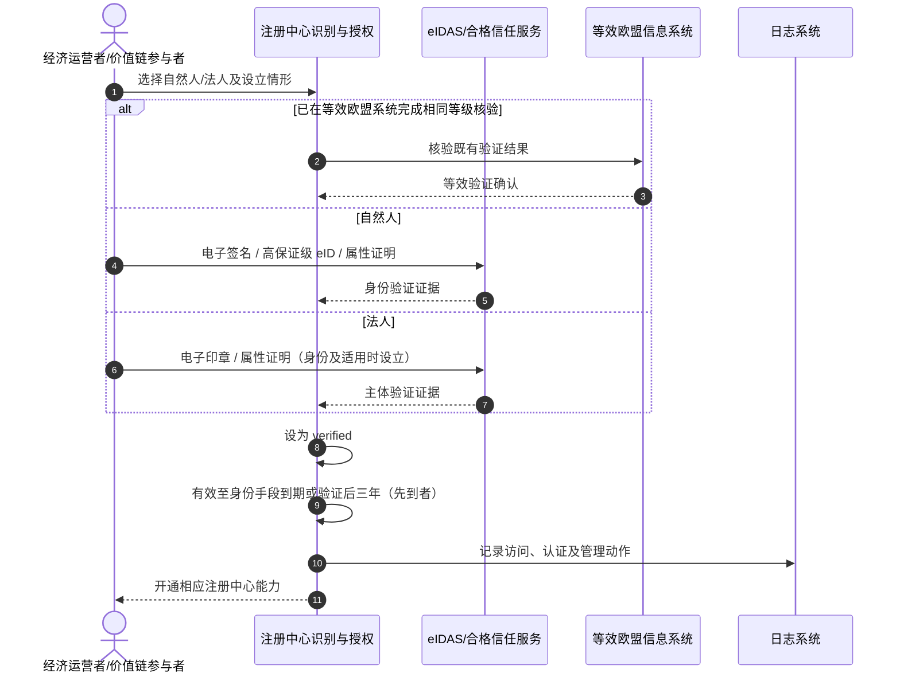

### 7.2 DPP 登记与自动校验

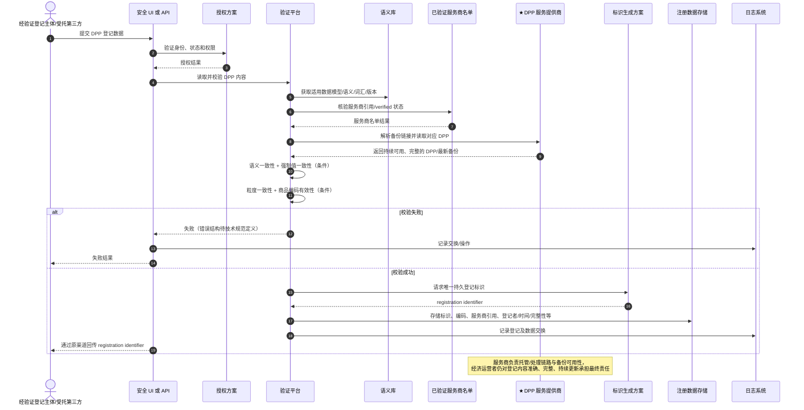

### 7.3 粒度与标识关联规则

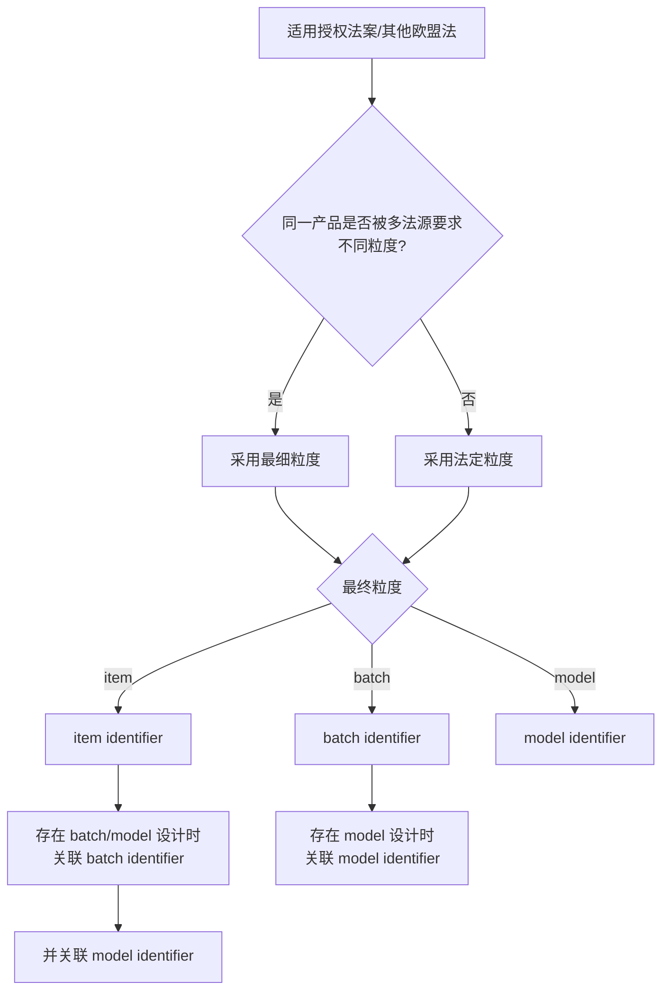

### 7.4 登记证明生成与下载

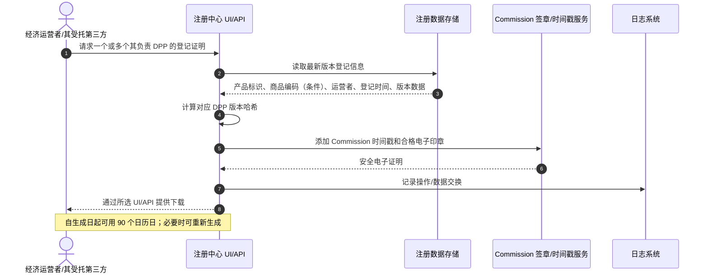

### 7.5 更新、转移、删除生命周期

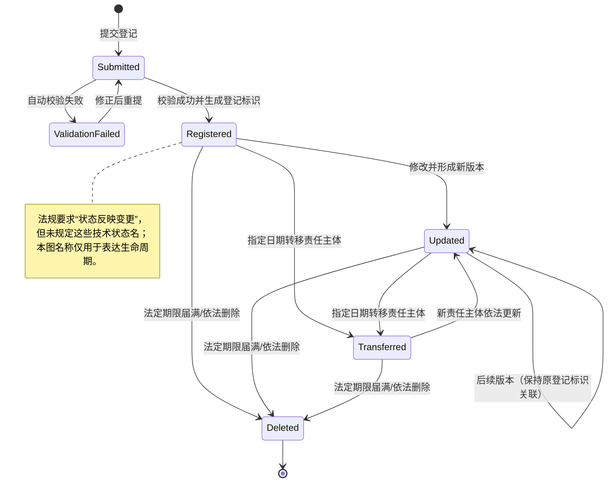

### 7.6 国家机关授权与互联

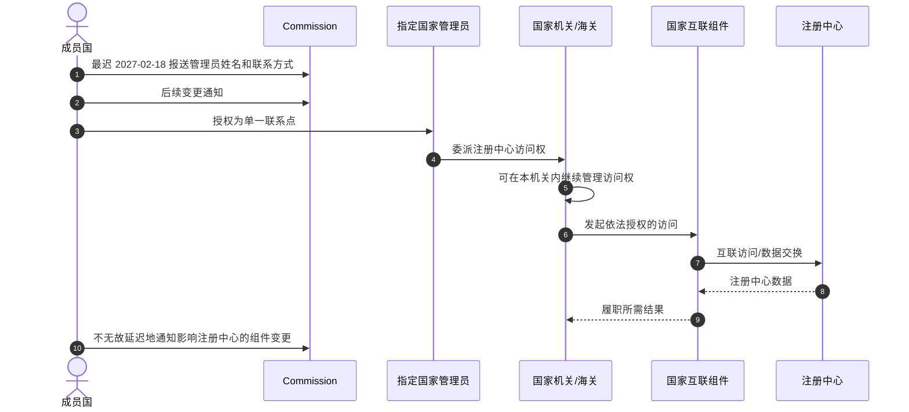

### 7.7 日志、审计与调阅

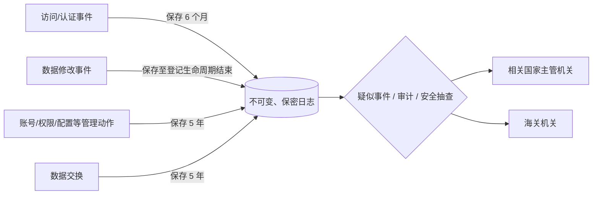

### 7.8 语义库发布与消费

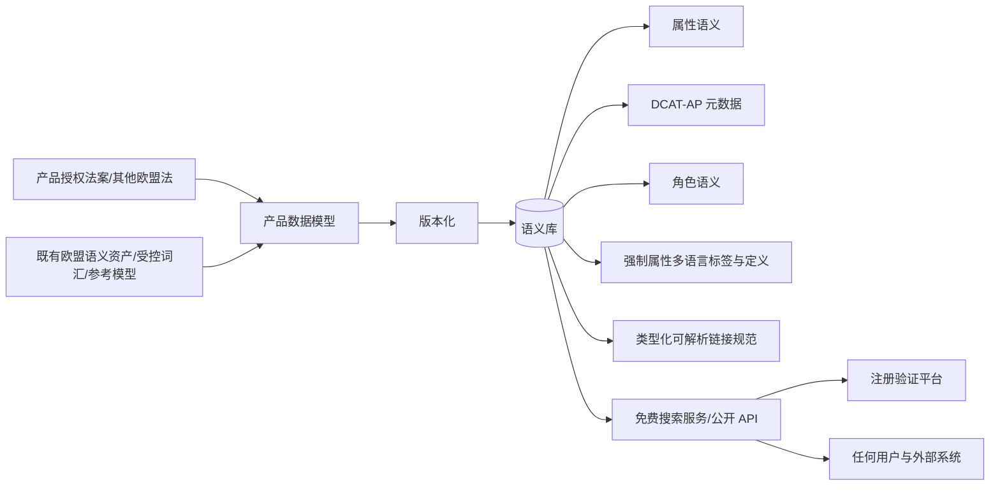

## 8. 图例

### 8.1 通用节点图例

| 图形/记号 | 含义 |
|---|---|
| 人形/`actor` | 人员、组织角色或法律责任主体 |
| 普通矩形 | 系统、服务、处理步骤或数据对象 |
| 圆柱体 | 持久化数据存储 |
| 菱形 | 条件判断/分支 |
| 实线箭头 `-->` | 同步调用、数据流或明确交互 |
| 虚线箭头 `-.->` | 支持性、非主链路或条件交互 |
| `alt/else` | 互斥条件分支 |
| `Note` | 法规边界、期限或非接口约束 |

### 8.2 确定性图例

| 视觉约定 | 含义 |
|---|---|
| 图中直接使用法规术语 | 原文明确的角色、系统、行为或数据概念 |
| 括号“条件”/“适用时” | 由产品法、授权法案或业务情形决定 |
| 括号“待定义” | 法规有业务要求但无技术契约 |
| 生命周期状态图中的英文状态名 | 为理解流程而设置的分析标签，不是法定状态枚举 |
| `★`、橙色粗边节点 | DPP 服务提供商，是本文补充后的主视角 |

## 9. 保留期限与时间要求

| 数据/事项 | 期限 | 起算/规则 | 来源 |
|---|---|---|---|
| 主体 verified 状态 | 最长 3 年 | 身份手段到期与验证后 3 年取先到；重新核验后恢复能力 | Articles 4(4), 5(4) |
| 登记证明可用 | 90 个日历日 | 从证明生成日起；可重新生成 | Article 9(4); Recital 17 |
| DPP 登记数据 | 默认 10 年 | 无其他欧盟法期限时从登记日起；有特殊期限则与 DPP 可用期一致 | Article 10(3) |
| 服务商托管 DPP | 产品授权法案规定期间 | 至少对应具体产品的预期寿命；运营者破产、清算或停止在欧盟活动后仍须可用 | 2024/1781 Articles 9(2)(i), 11(e) |
| 服务商备份版本 | 持续保持最新 | 制造商/进口商应确保服务商存储最新版本备份 | 2024/1781 Articles 27(1)(c), 29(2)(c) |
| 支持书面交流 | 6 个月 | 支持请求关闭后 | Article 13(2) |
| 访问/认证日志 | 6 个月 | 事件发生后 | Article 14(3)(a) |
| 行政动作日志 | 5 年 | 事件发生后 | Article 14(3)(b) |
| 数据交换日志 | 5 年 | 事件发生后 | Article 14(3)(b) |
| 数据修改日志 | 整个登记存续期间 | 随登记保留 | Article 14(3)(c) |
| 不可用日期/时间信息 | 不少于 5 年 | 注册被临时不可用/故障阻止时 | Article 15(4) |
| 国家管理员指定 | 最迟 2027-02-18 | 成员国指定并通知 Commission | Article 7(1)–(2) |
| 人工帮助台服务 | 全年每日 08:00–20:00（Brussels time） | 进一步运营细节由 Commission 网站公布 | Article 13(1) |
| 自动技术支持工具 | 2029-02 前上线 | 上线后全年 24 小时可用 | Article 13(1) |
| 条例评估 | 2032 年底前，之后每 6 年 | Commission 执行 | Article 23 |
| 条例生效 | 2026-08-06 | 2026-07-17 公布后第 20 日 | Article 24 |

## 10. 关键业务规则与非功能要求

1. 只有 verified economic operator 才能登记 Article 1(1)(a) 产品 DPP；价值链参与者只有在相关欧盟法明确时才可执行动作（Articles 4–5, 8）。
2. 身份核验失效后不能登记新 DPP 或修改数据，重新核验成功后才恢复（Articles 4(4), 5(4)）。
3. 同一产品被不同欧盟法要求不同粒度时，采用最细粒度（Article 8(3)）。
4. 登记必须可从安全 UI 或 API 发起，成功标识必须从相同所用服务回传（Article 8(6), 8(10)）。
5. 自动验证至少覆盖语义、适用时的强制数据一致性、粒度、商品编码范围和备份链接；不替代实质产品合规检查（Article 8(7); Recital 16）。
6. 登记数据必须版本化；每次更新保存 Commission 时间戳；创建、修改、删除全部记日志并反映登记状态（Article 10）。
7. 语义库必须权威、机器可读、免费，且通过有公开文档的 API 支持常见数据格式（Article 12）。
8. 注册中心除必要维护外应始终可访问；计划维护提前在公共网站通知，紧急故障/网络攻击/迫切安全需要可无预告暂停（Article 15）。
9. 日志须完整、准确、可靠、不可变且保密，并防止未授权/非法处理、意外丢失、破坏或损坏（Article 14）。
10. Commission 必须防止未授权访问/处理，检测未授权活动，防数据泄露并记录安全事件（Article 16）。
11. 对不当或欺诈使用（包括大规模数据下载）须采取预防、对抗与影响缓解措施；用户发现或合理怀疑恶意行为须立即报告（Article 17）。
12. Commission 是注册中心所有者和管理者；经济运营者/价值链参与者分别是其提交数据的控制者；成员国是其控制范围内处理的控制者（Articles 19–22）。
13. DPP 服务商必须是获经济运营者授权的独立第三方；仅在授权目的和有权角色范围内处理并提供 DPP 数据（2024/1781 Articles 2(32), 11）。
14. 服务商托管链路必须能证明保存的是最新 DPP 备份，而不是只保存最初登记版本（2024/1781 Articles 27(1)(c), 29(2)(c)）。
15. 服务商必须保障 DPP 在产品授权法案规定期间可用，包括责任运营者破产、清算或停止在欧盟活动之后（2024/1781 Article 11(e)）。
16. 服务商平台必须落实端到端互操作、开放格式、无厂商锁定、按角色访问控制、数据认证/可靠性/完整性以及高水平安全/隐私/防欺诈（2024/1781 Articles 10(1)(d), 11(a)–(h)）。
17. 未经与经济运营者的特定约定，服务商不得出售、复用或超出提供存储/处理服务所必要范围利用 DPP 数据（2024/1781 Article 11 第二款）。

## 11. Article 1–24 覆盖核对

| 条款 | 主题 | 本文覆盖位置 |
|---|---|---|
| Article 1 | 范围、实施事项 | §§2, 5, 6 |
| Article 2 | 定义 | §§1, 3, 6 |
| Article 3 | 九个注册中心组成 | §3 |
| Article 4 | 经济运营者核验 | §§4, 5, 6.1, 7.1 |
| Article 5 | 价值链参与者核验 | §§4, 5, 6.1, 7.1 |
| Article 6 | 用户档案与委派 | §§4, 5, 6.1–6.2 |
| Article 6a | DPP 转移 | §§5, 6.7, 7.5 |
| Article 7 | 国家机关与管理员 | §§4, 5, 6.2, 7.6 |
| Article 8 | DPP 登记 | §§4.2, 5, 6.3–6.5, 7.2–7.3 |
| Article 9 | 登记证明 | §§5, 6.6, 7.4, 9 |
| Article 10 | 登记数据管理 | §§5, 6.7, 7.5, 9 |
| Article 11 | 数据模型 | §§3, 6.8, 7.8 |
| Article 12 | 语义库 | §§3, 5, 6.8, 7.8 |
| Article 13 | 技术支持 | §§3, 5, 6.9, 9 |
| Article 14 | 日志系统 | §§3, 5, 6.9, 7.7, 9 |
| Article 15 | 维护和可用性 | §§5, 6.9, 9–10 |
| Article 16 | 安全与技术审计 | §10 |
| Article 17 | 不当/欺诈使用 | §§5, 6.9, 10 |
| Article 18 | 个人数据 | §6.1 |
| Article 19 | 经验证经济运营者责任 | §4, §10 |
| Article 20 | 经验证价值链参与者责任 | §4, §10 |
| Article 21 | Commission 责任 | §§3–5, 10 |
| Article 22 | 成员国责任 | §§3–5, 7.6, 10 |
| Article 23 | 监测与评估 | §9 |
| Article 24 | 生效 | 不形成接口/字段；已核对 |

### 11.1 服务商补充法源覆盖核对（Regulation (EU) 2024/1781）

| 条款 | 服务商相关要求 | 本文覆盖位置 |
|---|---|---|
| Article 2(32) | 独立第三方、运营者授权、处理目的和有权访问者 | §§1, 4.2, 5, 6.3 |
| Article 9(2)(f)–(i) | 产品级访问者、创建/更新者、操作安排和可用期间 | §§4.2, 6.3 |
| Article 10(1), 10(4) | 开放互操作/无锁定；通过服务商提供备份 | §§4.2, 5, 6.3 |
| Article 11(a)–(h) | 互操作、访问、存储、关联、连续性、权限、可信、安全 | §§4.2.1–4.2.4, 5, 6.3 |
| Article 11 第二款 | 禁止无特定约定的数据出售、复用和超范围处理 | §§4.2.1–4.2.5, 6.3, 10 |
| Article 11 第三款 | 后续服务商要求和可能的认证方案 | §§4.2.1, 4.2.5, 6.3, 12 |
| Article 27(1)(c) | 制造商确保服务商保存最新版本备份 | §§4.2, 5, 6.3, 10 |
| Article 29(2)(c) | 进口商核验服务商保存最新版本备份 | §§4.2, 5, 6.3, 10 |

## 12. 待后续法源/技术规范补齐的缺口清单

| 缺口 | 为什么本条例无法给出 | 建议权威来源 |
|---|---|---|
| 各产品 DPP 属性全集 | Article 11 明确按产品组授权法案/其他欧盟法建模 | 产品授权法案、相应产品法规、语义库 |
| DPP API 路径与报文 | Article 3/8/9 只规定能力和渠道 | Commission 发布的注册中心 API 文档/OpenAPI |
| 语义库 API 路径与查询参数 | Article 12 要求“公开文档化”，但本 PDF 不含文档 | 未来语义库 API 文档 |
| 状态枚举与状态机 | Article 1/10 只要求状态被反映 | 注册中心技术规范 |
| 权限编码和最小权限模型 | Articles 6–7 只规定委派责任 | IAM/授权技术规范、适用法律 |
| 错误码与校验错误明细 | Article 8 只列校验项目 | API/OpenAPI 与验证平台规范 |
| 唯一标识格式/编码方案 | 仅要求唯一、持久 | Article 3(d) 对应技术方案 |
| 商品编码制式与产品允许范围 | 按产品组和海关要求而异 | 产品法、海关商品编码规则、验证规则 |
| 登记证明文件/签章容器格式 | 仅要求安全电子文档、合格印章和时间戳 | eIDAS 实施标准、Commission 技术规范 |
| 日志逐字段 Schema/检索协议 | Article 14 只列事件类别和期限 | Commission 日志/审计接口规范 |
| DPP 服务商验证和名单字段 | 2026/1778 只要求已验证名单，未给名单 Schema 和准入流程 | Commission 服务提供商注册/认证规范 |
| DPP 服务商资格及认证细则 | 2024/1781 Article 11 授权 Commission 后续补充，现有法源未给完整证书/吊销/续期规则 | 后续授权法案和可能的认证方案 |
| 服务商授权书/数据处理约定格式 | 只明确独立第三方授权关系和用途限制 | 经济运营者—服务商合同、数据处理协议、后续服务商规范 |
| 服务商 DPP 托管/读取/更新 API | 只规定开放、互操作、可访问和权限结果 | 协调标准、共同规范、产品授权法案、服务商 API 契约 |
| 服务商迁移与退出接口 | 法规要求无厂商锁定和持续可用，但未给迁移包/时序 | 后续技术标准、服务合同与业务连续性方案 |
| 转移、手工删除、账号删除工作流 | 只规定权利/结果 | 注册中心操作/API 规范 |
| 国家互联协议 | Article 22 只界定所有权和责任 | Commission—成员国互联技术规范 |

## 13. 可直接用于需求评审的验收清单

- [ ] 九个 Article 3 组件均有系统边界、所有者和可用接口说明。
- [ ] 经济运营者与价值链参与者分别实现自然人/法人、欧盟设立/非欧盟设立核验分支。
- [ ] verified 有效期取身份手段到期与三年期限的先到者。
- [ ] 身份过期后阻断新登记和修改，重新核验后恢复。
- [ ] 支持第三方权限委派，并保证委托主体责任不转移。
- [ ] 支持 DPP 责任转移及指定生效日期。
- [ ] 支持国家管理员、国家机关和机关内部的分层权限委派。
- [ ] UI 与 API 均支持 DPP 登记；成功标识通过原渠道返回。
- [ ] 注册校验覆盖 Article 8(7)(a)–(e)，且不将其展示为产品合规证明。
- [ ] model/batch/item 粒度和跨粒度标识关联满足 Article 8(3)–(5)。
- [ ] Article 8(8)–(9) 的注册数据均可持久化并可追踪。
- [ ] 支持一个或多个 DPP 的证明生成；证明包含 Article 9(2)(a)–(e)，有合格印章和时间戳。
- [ ] 登记证明 90 日可用并可重新生成。
- [ ] 登记数据支持版本化、每次更新时间戳、状态反映和全操作日志。
- [ ] 默认 10 年与产品法特殊保留期可配置。
- [ ] 语义库资产覆盖 Article 12(2)(a)–(e)，模型版本化，元数据符合 DCAT-AP。
- [ ] 语义库搜索和公开 API 免费并支持常见机器可读格式。
- [ ] 四类日志的保留期限分别可执行；日志不可变且保密。
- [ ] 计划维护、紧急暂停和不可用日期时间留存机制完整。
- [ ] 技术支持服务、六个月交流留存和市场监管调阅可执行。
- [ ] 个人数据字段、控制者边界及删除/审计留存冲突处理有明确设计。
- [ ] 防未授权访问/处理、检测、泄露防护、安全日志与反大规模下载控制可验证。

服务商重点验收：

- [ ] 能证明服务商为独立第三方，并能追溯每个经济运营者的有效授权、产品/DPP 范围、目的和期限。
- [ ] 完成价值链参与者身份核验，并能同步/核验注册中心中的服务商名单状态。
- [ ] 每个登记 DPP 均能提供可解析的服务商引用和备份链接，注册中心可自动读取验证。
- [ ] 能证明备份与最新 DPP 版本同步，并保持原 DPP、替代 DPP 和各版本之间的关系。
- [ ] 按产品授权法案角色实施读取、写入、修改和更新权限；未授权访问被拒绝并可审计。
- [ ] 有权角色可以免费、便捷地访问其获授权 DPP 数据。
- [ ] 技术、语义和组织互操作可验证；支持开放格式导出和服务商迁移，无 vendor lock-in。
- [ ] 可用性期限按产品配置，并有运营者破产、清算、停业或服务商退出时的连续性预案。
- [ ] 数据认证、可靠性、完整性、安全、隐私和防欺诈控制有测试证据和审计记录。
- [ ] 默认禁止 DPP 数据出售、复用和超必要范围处理；例外必须关联可追溯的特定约定和合法性依据。
- [ ] 代登记必须同时校验运营者授权和服务商 verified 状态，并明确运营者最终责任不转移。
- [ ] 服务商认证、吊销、续期和迁移机制可配置，以承接 Commission 后续授权法案。

---

### 原始资料

- `20260717 注册中心正式条例 OJ_L_202601778_EN_TXT.pdf`
- [Regulation (EU) 2024/1781 官方英文文本](https://eur-lex.europa.eu/eli/reg/2024/1781/oj/eng)

未注明法规编号的 Article 引用均指本目录 PDF 内 Commission Implementing Regulation (EU) 2026/1778；标注“2024/1781”的引用指上列官方上位条例。序言只用于解释正文，若序言与正文实现表述出现差异，应以正文义务及其上位/专项法源为准。
