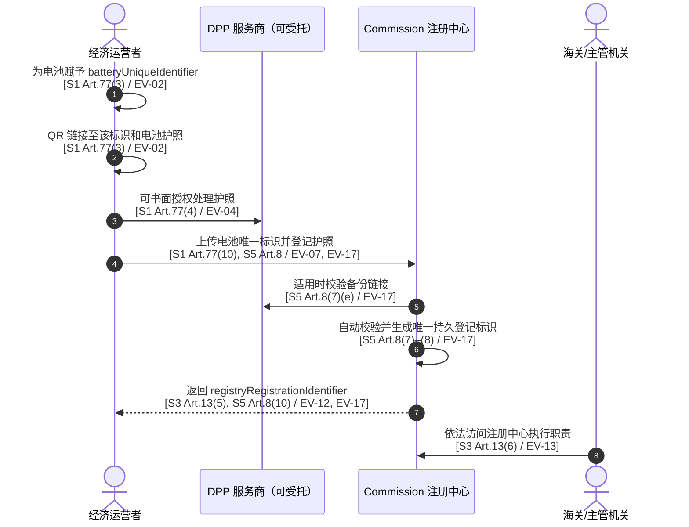

# 电池护照唯一标识符与电池唯一标识符：法规依据与接口映射

> 版本：v1.1，2026-07-20  
> 目标：严格区分电池本体标识、注册中心登记标识以及非正式的“电池护照 ID”叫法；每项结论均关联本地法规文件、具体 Article 和证据编号。  
> 来源索引：[法规依据/README.md](法规依据/README.md)

## 1. 最终结论

### 结论 C-01：法规明确存在两类不同标识

| 推荐业务名称 | 法规英文术语 | 产生主体 | 法律功能 | 直接依据 |
|---|---|---|---|---|
| **电池唯一标识符** | `unique identifier`；在一般 DPP 框架中对应 `unique product identifier` 的功能 | 将电池投放市场的经济运营者赋予 | 唯一识别电池；QR 码链接到该标识，并由该标识访问电池护照 | EV-02, EV-03, EV-08, EV-09 |
| **注册中心唯一登记标识符** | `unique registration identifier` | Commission 注册中心在成功登记后自动生成 | 唯一定位注册中心中的登记；关联登记时上传的一个或多个唯一标识 | EV-12, EV-17 |

依据：Battery Regulation 使用 `unique identifier`；ESPR 和注册中心实施条例另行使用 `unique registration identifier`，且明确后者由注册中心生成并关联前者。[S1 Article 77(3), 77(10)]、[S3 Article 13(1), 13(5)]、[S5 Article 8(8)–(10)]。

### 结论 C-02：“电池护照唯一标识符”不是现有三部法规中的独立定义术语

法规规定电池护照通过 QR 码访问，而 QR 码链接至经济运营者赋予电池的 `unique identifier`。法规没有再定义一个与电池唯一标识平行的 `battery passport unique identifier`。如果业务材料写“电池护照唯一标识符”，必须注明它究竟是：

1. 电池唯一标识符；还是
2. 注册中心唯一登记标识符；或
3. 纯内部的护照资源 URI/数据库主键。

第三项不是法定标识，不得作为前两项的替代品。依据：EV-02、EV-08、EV-12、EV-20。

### 结论 C-03：建议系统只使用两个无歧义字段名

```text
batteryUniqueIdentifier       // 电池唯一标识符，法规业务字段
registryRegistrationIdentifier // 注册中心唯一登记标识符，注册成功后的系统生成字段
```

这两个英文键名是本文建议的内部 API 命名，不是法规规定的 JSON key；法规只规定业务语义，未规定字段名、类型、长度或报文结构。依据：EV-02、EV-12、EV-17、EV-21。

## 2. 两类标识符的法规级对照

| 对比项 | 电池唯一标识符 | 注册中心唯一登记标识符 | 法规依据 |
|---|---|---|---|
| 原文术语 | `unique identifier` | `unique registration identifier` | EV-02, EV-12 |
| 识别对象 | 电池/产品 | 某个产品的注册中心登记 | EV-02, EV-12, EV-17 |
| 生成/赋予方 | 经济运营者 | Commission 注册中心 | EV-02, EV-12, EV-17 |
| 产生时点 | 制作 QR 和电池护照关联时，且登记前必须已经存在 | 登记数据成功提交并通过自动验证后 | EV-02, EV-07, EV-17 |
| 是否由服务商生成 | 法规责任主体为经济运营者；可书面授权其他运营者代办，但责任规则不变 | 否；只能由注册中心生成 | EV-02, EV-04, EV-12, EV-19 |
| 与 QR 的关系 | QR 码链接到该标识 | 法规未要求写入电池 QR | EV-02, EV-20 |
| 与 DPP 的关系 | 该标识同时使 DPP/电池护照可通过链接访问 | 指向注册中心登记记录，不是护照内容地址 | EV-08, EV-09, EV-12 |
| 是否上传注册中心 | 是 | 不作为输入上传；它是输出 | EV-07, EV-12, EV-17 |
| 标准要求 | ISO/IEC 15459-1 至 15459-6 或等同标准 | 格式/编码方案尚未在三部法规中规定 | EV-03, EV-21 |
| 注册中心关系 | 被注册中心存储 | 与上传的唯一标识关联并被注册中心存储 | EV-10, EV-12, EV-17 |
| 登记证明 | 证明至少包含 unique product identifier | 证明由对应登记生成，但 Article 9 未把登记标识列入证明最小字段清单 | EV-18 |
| 海关关系 | 注册中心内部可关联；不是 ESPR Article 15 明定的海关最小输入 | 对 ESPR Article 4 授权法案产品，是 Article 15 明定的海关输入 | EV-14, EV-15, EV-22 |

## 3. 电池唯一标识符证据链

### 3.1 哪些电池需要电池护照

从 2027-02-18 起，每一个 LMT 电池、容量大于 2 kWh 的工业电池和电动汽车电池，在投放市场或投入使用时都必须有电池护照。依据：EV-01（S1 Article 77(1)；S2 Article 77(1)）。

### 3.2 谁赋予电池唯一标识

电池护照通过 Article 13(6) 的 QR 码访问，该 QR 码链接至一个唯一标识；该标识由将电池投放市场的经济运营者赋予。依据：EV-02（S1 Article 77(3)；S2 Article 77(3)）。

### 3.3 标识格式遵循什么标准

QR 码和电池唯一标识须符合 ISO/IEC 15459-1:2014 至 15459-6:2014 或等同标准；Commission 可通过授权法案替换或增加标准。依据：EV-03（S1 Article 77(3)；S2 Article 77(3)）。

### 3.4 谁对标识及护照内容负责

投放市场的经济运营者负责确保电池护照信息准确、完整且持续更新，并可书面授权其他运营者代表其执行。该授权不等于把注册中心的标识生成权转给服务商。依据：EV-04（S1 Article 77(4)；S2 Article 77(4)）和 EV-19。

### 3.5 为什么必须上传注册中心

经 2024/1781 修订后，Battery Regulation Article 77(10) 要求将电池投放市场或投入使用的经济运营者把 `unique identifier` 上传至 Regulation 2024/1781 Article 13(1) 的注册中心。依据：EV-07（S1 Article 77(10)；S4 对 S3 Article 78 的官方勘误）。

### 3.6 生命周期变化

经再使用准备、再利用、再制造等处理的电池应有新的电池护照，并与原电池护照建立链接；电池被回收后，其电池护照终止存在。法规没有在这些条款中完整规定新旧唯一标识的重用/换发技术规则，因此不得自行推定。依据：EV-05、EV-06（S1 Article 77(7)–(8)）。

## 4. 注册中心唯一登记标识符证据链

### 4.1 注册中心存什么

ESPR 注册中心至少安全存储唯一标识；对于拟进入“自由流通放行”程序的产品还存储商品编码；并明确存储 Battery Regulation Article 77(3) 的电池唯一标识。依据：EV-10（S3 Article 13(1)）。

### 4.2 登记数据由谁上传

ESPR Article 13(4) 规定，将产品投放市场或投入使用的经济运营者上传 Article 13(1)–(2) 数据。Battery Regulation Article 77(10) 又专门规定电池唯一标识的上传义务。依据：EV-07、EV-11。

### 4.3 登记标识由谁产生

上传成功后，注册中心自动向经济运营者返回 `unique registration identifier`，该登记标识与为特定产品上传的唯一标识相关联。依据：EV-12（S3 Article 13(5)）。

### 4.4 2026/1778 如何落实生成规则

最终实施条例把电池纳入注册中心范围；提交后自动校验 DPP/电池护照语义一致性、适用粒度、适用商品编码和适用服务商备份链接。校验成功后，注册中心生成并保存唯一且持久的登记标识，并从原 UI 或 API 渠道回传。依据：EV-16、EV-17（S5 Articles 1(1)(b), 2, 8(2), 8(7)–(10)）。

时间边界：S5 于 2026-07-17 发布，依 Article 24 在发布后第 20 日、即 2026-08-06 生效。S3 Article 13(1) 要求 Commission 最迟在 2026-07-19 建立注册中心，但“法定建设期限届满”本身不能证明某个生产接口已经对外开放。服务商上线前仍须核验 Commission 的实际开放状态、身份验证入口和 API 文档。依据：EV-23。

### 4.5 登记证明证明什么

登记者可生成安全电子登记证明。证明至少包含唯一产品标识、适用商品编码、负责登记的经验证经济运营者名称和身份、最新版本登记日期时间以及 DPP 版本哈希，并由 Commission 合格电子印章和时间戳保护。依据：EV-18（S5 Article 9(1)–(4)）。

登记证明只证明已履行登记义务，不等于证明电池符合全部产品、市场监管或海关实体要求。依据：EV-18（S5 Article 9(2)）及 S3 Article 13(5)。

## 5. 标识符产生与传递流程图



## 6. 注册接口字段映射

### 6.1 法规业务输入与输出

| 方向 | 业务字段 | 法规属性 | 说明 | 依据 |
|---|---|---|---|---|
| 输入 | 电池唯一标识符 | 明确必需 | Battery Regulation 明确要求上传 | EV-02, EV-07 |
| 输入 | 电池护照内容/可读取表示 | 明确业务对象 | Commission 提交后读取并校验内容；报文方式未规定 | EV-16, EV-17 |
| 输入 | 登记粒度 | 明确，具体值按电池法 | 2026/1778 对电池按相关欧盟法规定的 model/batch/item 登记 | EV-17 |
| 输入 | 商品编码 | 条件 | 拟自由流通及相关场景存储/校验；电池具体必填矩阵待接口规范 | EV-10, EV-17, EV-22 |
| 输入 | DPP 服务商引用 | 条件 | 使用服务商时作为注册数据保存 | S5 Article 8(9)(c) |
| 输入 | 服务商备份链接 | 条件 | 适用时由注册中心自动验证 | S5 Article 8(7)(e) |
| 系统生成 | 登记者、登记日期时间、完整性证据 | 明确存储 | 由注册中心作为登记事件证据保存；精确报文结构未规定 | S5 Article 8(9)(d) |
| 输出 | 注册中心唯一登记标识符 | 明确系统生成 | 成功验证后唯一、持久、存储并回传 | EV-12, EV-17 |
| 输出 | 登记证明 | 按需生成 | 证明已履行登记义务；最小字段见 S5 Article 9(2) | EV-18 |

### 6.2 建议内部报文，仅作实施映射

```json
{
  "batteryUniqueIdentifier": "由经济运营者赋予；S1 Article 77(3)",
  "batteryPassport": "内容或可读取表示；S5 Article 8(7)",
  "granularity": "按电池适用法；S5 Article 8(2)",
  "commodityCode": "适用时；S3 Article 13(1), S5 Article 8(9)(b)",
  "serviceProviderReference": "适用时；S5 Article 8(9)(c)",
  "backupLink": "适用时；S5 Article 8(7)(e)"
}
```

概念响应：

```json
{
  "registryRegistrationIdentifier": "由注册中心生成；S3 Article 13(5), S5 Article 8(8)–(10)"
}
```

以上键名是内部建议。S5 没有提供 OpenAPI、JSON Schema、字段英文键名、数据类型、错误码和长度约束。依据：EV-21。

## 7. 海关查询入参与电池适用边界

### 7.1 ESPR Article 15 明确的查询规则

对于 Regulation 2024/1781 Article 4 授权法案覆盖、拟进入自由流通放行的产品：申报方提供或使海关可获得注册中心唯一登记标识；海关至少自动核对该登记标识与商品编码是否和注册中心数据一致。依据：EV-14、EV-15（S3 Article 15(1)–(3)）。

概念查询为：

```json
{
  "registryRegistrationIdentifier": "S3 Article 15(1)",
  "commodityCode": "S3 Article 15(2)"
}
```

### 7.2 不能直接扩大到电池的部分

S3 Article 15(1) 的直接文字范围是“covered by a delegated act adopted pursuant to Article 4”的产品。电池护照来自 Regulation 2023/1542 Article 77，而不是 ESPR Article 4 授权法案。因此，仅依据目前三部法规，不能把 S3 Article 15 的两项参数直接宣称为所有电池海关申报已经生效的法定必填字段。依据：EV-14、EV-22。

能够确定的是：

1. 电池唯一标识必须上传 DPP 注册中心（EV-07）；
2. 注册中心明确存储电池唯一标识（EV-10）；
3. 2026/1778 将电池纳入登记范围（EV-16）；
4. 海关依法有权访问注册中心（EV-13）；
5. 商品编码在适用情况下由注册中心存储和校验（EV-10、EV-17）。

电池专属海关申报数据元素、自动查询报文、强制上线日期及异常处置仍需 Commission、EU CSW-CERTEX、UCC 数据要求或成员国海关正式实施文件补齐。依据：EV-21、EV-22。

另需区分两个时间条件：ESPR Article 15(1) 的申报义务自注册中心实际运行时适用；Article 15(2) 的自动核验自 EU CSW-CERTEX 互联实际运行时适用，且互联法定期限为 S5 生效后四年内。上述 Article 15 仍受“Article 4 授权法案产品”的直接适用范围限制，不能据此直接断言电池已经适用。依据：EV-14、EV-15、EV-22、EV-23。

### 7.3 服务商现阶段应准备的数据交付

服务商不应等待海关字段最终发布才建立标识映射。为支持后续海关和监管接入，建议维护以下关联；其中法定数据来源均已标出，额外运维字段标记为“实施建议”。

| 字段 | 性质 | 依据 |
|---|---|---|
| batteryUniqueIdentifier | 法规明确 | EV-02, EV-07 |
| registryRegistrationIdentifier | 法规明确、注册中心输出 | EV-12, EV-17 |
| commodityCode | 条件法规字段 | EV-10, EV-15, EV-17 |
| passportUrl / data carrier resolution | 法规功能，字段名待定义 | EV-02, EV-08, EV-09 |
| serviceProviderReference | 条件法规字段 | S5 Article 8(9)(c) |
| backupLink | 条件法规字段 | S5 Article 8(7)(e) |
| passportVersionHash | 登记证明明确，服务端字段设计待定义 | EV-18 |
| registrationTimestamp | 登记证明明确 | EV-18 |
| registrationProofReference | 实施建议 | S5 Article 9 |
| customsSubmissionStatus | 实施建议，非现行法规字段 | EV-21, EV-22 |

## 8. 法规证据表

| 证据 ID | 可支持的结论 | 本地文件 | 条款/页码 |
|---|---|---|---|
| EV-01 | 电池护照适用种类及 2027-02-18 起始日期 | [S1](法规依据/Regulation_EU_2023_1542_consolidated_2025-07-31_EN.pdf)；[S2](欧盟新电池法案.pdf) | Article 77(1)；S1 合并文本标页 82；S2 OJ L 191/72 |
| EV-02 | QR 链接到电池唯一标识；标识由投放市场的运营者赋予 | S1；S2 | Article 77(3)；S1 标页 83–84；S2 OJ L 191/73 |
| EV-03 | QR 和唯一标识适用 ISO/IEC 15459 系列或等同标准 | S1；S2 | Article 77(3) 第二款 |
| EV-04 | 运营者负责护照准确完整更新，可书面授权其他运营者 | S1；S2 | Article 77(4) |
| EV-05 | 再使用/再利用/再制造电池建立新护照并链接原护照 | S1；S2 | Article 77(7) |
| EV-06 | 电池回收后电池护照终止 | S1；S2 | Article 77(8) |
| EV-07 | 经济运营者把电池唯一标识上传注册中心 | S1；[S4](法规依据/Regulation_EU_2024_1781_Corrigendum_2024-08-07_EN.pdf) | S1 Article 77(10)，标页 85；S4 Article 78 勘误，p.1 |
| EV-08 | unique product identifier 的一般 DPP 定义 | [S3](<ESPR (EU)2024 1781.pdf>) | Article 2(30) |
| EV-09 | DPP 通过数据载体连接到持久 unique product identifier | S3 | Article 10(1)(a)–(c)，OJ 39/89 |
| EV-10 | 注册中心存唯一标识、适用商品编码及电池唯一标识 | S3 | Article 13(1)，OJ 42/89 |
| EV-11 | 经济运营者上传 Article 13(1)–(2) 数据 | S3 | Article 13(4)，OJ 43/89 |
| EV-12 | 注册中心自动返回与上传标识关联的唯一登记标识 | S3 | Article 13(5)，OJ 43/89 |
| EV-13 | Commission、主管机关和海关有权访问注册中心履职 | S3 | Article 13(6)，OJ 43/89 |
| EV-14 | ESPR Article 4 产品的申报方向海关提供登记标识 | S3 | Article 15(1)，OJ 43/89 |
| EV-15 | 海关自动核对登记标识和商品编码 | S3 | Article 15(2)–(3)，OJ 43/89 |
| EV-16 | 最终注册中心实施条例范围包括 Article 77 电池护照 | [S5](<20260717 注册中心正式条例 OJ_L_202601778_EN_TXT.pdf>) | Articles 1(1)(b), 2，OJ 7–9/20 |
| EV-17 | 电池登记、自动校验、生成/存储/回传唯一持久登记标识 | S5 | Article 8(2), 8(7)–(10)，OJ 13–14/20 |
| EV-18 | 登记证明的性质、字段、签章、时间戳和 90 日可用期 | S5 | Article 9(1)–(4)，OJ 14–15/20 |
| EV-19 | 服务商不能生成 Commission 登记标识 | S3 + S5 的直接逻辑结论 | S3 Article 13(5)；S5 Article 8(8)–(10) |
| EV-20 | 三部法规没有另设 battery passport unique identifier 定义 | S1 Article 77；S3 Articles 2, 10, 13；S5 Articles 2, 8, 9 的术语核对 | 全文精确短语检索为 0；法规实际使用 `unique identifier`、`unique product identifier`、`unique registration identifier` |
| EV-21 | 现有法规没有规定 API 字段名和完整报文 Schema | S3 Articles 13, 15；S5 Articles 3, 8, 9 | 只规定接口能力和业务数据；未给 OpenAPI/JSON Schema |
| EV-22 | ESPR 自动海关参数的直接条文范围没有明确包括 Battery Regulation Article 77 电池 | S3 + S5 | S3 Article 15(1) 的 Article 4 限定；S5 Article 1(1)(b) 只证明电池纳入注册中心 |
| EV-23 | 注册中心法规、申报义务和海关自动互联的时间边界 | S3；S5 | S3 Article 13(1), 15(1)–(3)；S5 Article 24；S5 于 2026-08-06 生效，实际接口开放状态需另行核验 |

## 9. 文件版本与勘误说明

### 9.1 为什么必须同时引用 S1 和 S4

S2 是 2023/1542 原始正式文本，所以 Article 77 只到第 9 款；2024/1781 Article 78 后来为其新增第 10 款。S1 是已经合并该修订的文本，可直接看到 Article 77(10)。依据：EV-07。

### 9.2 ESPR 原 PDF 的编号错误

S3 原始 PDF 在 Articles 77–78 把自身编号误印为 `2024/1726`；S4 官方勘误将其更正为 `2024/1781`。引用“电池唯一标识上传注册中心”的最终依据时，应以 S4 修正后的条文或 S1 合并文本为准。

### 9.3 不采用注册中心草案

`DPP注册中心原文.pdf` 明确标为 draft，并声明未被 Commission 采纳或认可；注册中心的生成、校验和证明规则只引用 S5 最终正式文本。

### 9.4 S5 Article 8 的内部交叉引用

S5 正式 PDF 的 Article 8(8) 写成“successful verification in accordance with paragraph 6”，但自动验证内容实际列在 Article 8(7)；Article 8(10) 又写登记标识“generated in accordance with paragraph 9”，而生成规则实际列在 Article 8(8)。本文把 Article 8(7)–(10) 作为连续业务链合并引用，不擅自改写正式文本；若 EUR-Lex 后续发布勘误，应以最新官方勘误为准。

## 10. 不得作出的无依据断言

- 不得说“QR 码内容就是注册中心唯一登记标识”；S1 Article 77(3) 明确 QR 链接的是经济运营者赋予的电池唯一标识。
- 不得说“DPP 服务商生成 EU 登记标识”；S3 Article 13(5) 与 S5 Article 8 明确由注册中心生成。
- 不得把数据库内部主键、护照 URL、二维码字符串和登记标识合并为同一个字段。
- 不得声称当前法规已经给出正式 API 字段名、长度、正则、错误码或 OpenAPI。
- 不得仅凭 S3 Article 15 就声称登记标识已经是所有电池海关申报的法定必填项；其直接文字范围有限，须等待电池海关实施文件确认。
- 不得把注册成功或登记证明解释成电池全部实质合规证明。

## 11. 后续答复引用规则

后续关于这两类标识符的每一项答复应至少给出：

1. 结论；
2. 证据 ID；
3. 本地法规文件；
4. Article/paragraph；
5. 若为推导或实施建议，必须显式标记“法规未直接规定”。

推荐格式：

```text
结论：注册中心登记标识由 Commission 注册中心生成。
依据：EV-12；S3《Regulation (EU) 2024/1781》Article 13(5)；
      EV-17；S5《Implementing Regulation (EU) 2026/1778》Article 8(8)–(10)。
性质：法规明确。
```
